# Relay: 100 Parallel Tasks Implementation Plan (Octavia's Track)

> **Roadmap Strategy**: Fully Decoupled & Parallel Ecosystem Workstreams (Engineered for Zero Interference with Sally's Active Runtime Track in [`PLAN_NEXT_100_TASKS.md`](./PLAN_NEXT_100_TASKS.md)).
> **Assigned Agent**: Octavia Smith (`octavia@paddy.systems`)
> **Source of Truth Reference**: [`apps/relay/RELAY_DEVELOPMENT_CHECKLIST.md`](./RELAY_DEVELOPMENT_CHECKLIST.md)
> **Architectural Standard**: `~/.config/agents/engineering.md`

---

## Strategic Objective & Codespace Concurrency Guarantee

This plan defines **100 concrete, high-leverage engineering tasks** (`TASK-201` through `TASK-300`) designed to execute concurrently within the exact same codespace alongside Sally's active work on [`PLAN_NEXT_100_TASKS.md`](./PLAN_NEXT_100_TASKS.md).

To prevent git conflicts, dirty tree race conditions, or build collisions, Octavia's workstreams operate in **completely distinct, dedicated packages and workspaces** that do not overlap with Sally's target directories:

| Workstream / Focus Area | Octavia's Dedicated Target | Sally's In-Flight Target ([`PLAN_NEXT_100_TASKS.md`](./PLAN_NEXT_100_TASKS.md)) | Collision Risk |
| :--- | :--- | :--- | :--- |
| **Replay & Time-Travel Engine** | `packages/relay/replay` | `cloud-web` / `agent` UI | **Zero** (Isolated Engine package) |
| **Desktop Receiver & Multi-Window Shell** | `apps/relay/desktop` | `ios` / `android` receivers | **Zero** (Isolated Desktop application) |
| **Browser Extension & DevTools Panel** | `apps/relay/extension` | Dev server reverse proxy | **Zero** (Isolated Manifest V3 extension) |
| **IDE Extensions & Workflow Tooling** | `apps/relay/vscode` | CLI gateway runtime | **Zero** (Isolated VS Code extension) |
| **Python & Django Ecosystem SDK** | `packages/relay/python` | Node / TypeScript plugins | **Zero** (Isolated Python package) |
| **Terminal UI Component Library** | `packages/relay/cli-ui` | CLI process orchestrator | **Zero** (Isolated pure TUI library) |
| **Synthetic Device Farm Simulator** | `packages/relay/simulation` | Edge proxy / Production SRE | **Zero** (Isolated test load generator) |
| **WebAssembly High-Performance Layer** | `packages/relay/wasm` | JavaScript/TypeScript transport | **Zero** (Isolated Rust/WASM module) |
| **Security Governance & Audit Vault** | `packages/relay/security` | Cloud API routes / Logto SSO | **Zero** (Isolated cryptographic package) |
| **Documentation Portal & Specifications** | `apps/relay/docs` | Application runtime | **Zero** (Isolated static docsite) |

---

## Architectural Overview: Parallel Ecosystem Mesh

```mermaid
flowchart TD
    subgraph SallyTrack ["Sally's Active Track (PLAN_NEXT_100_TASKS)"]
        S_EDGE["apps/relay/cloud-edge"]
        S_IOS["apps/relay/ios"]
        S_PLUGINS["packages/relay/integrations"]
        S_CONTROLS["packages/relay/capabilities"]
        S_INSPECT["apps/relay/cloud-web & local-web"]
        S_MEDIA["packages/relay/media & android"]
        S_TEAMS["apps/relay/api"]
        S_CI["relay ci & GitHub Actions"]
        S_SRE["Cloud Infrastructure & Operations"]
    end

    subgraph OctaviaTrack ["Octavia's Parallel Track (PLAN_100_PARALLEL_TASKS)"]
        O_REPLAY["packages/relay/replay (Deterministic Player)"]
        O_DESKTOP["apps/relay/desktop (Native Tauri Shell)"]
        O_EXT["apps/relay/extension (DevTools Panel)"]
        O_IDE["apps/relay/vscode (Cursor / VS Code)"]
        O_PYTHON["packages/relay/python (Django / FastAPI SDK)"]
        O_TUI["packages/relay/cli-ui (Pure Ink Components)"]
        O_SIM["packages/relay/simulation (Synthetic Device Farm)"]
        O_WASM["packages/relay/wasm (SIMD Decompressor)"]
        O_SEC["packages/relay/security (Audit & Merkle Vault)"]
        O_DOCS["apps/relay/docs (Interactive Specs & ADRs)"]
    end

    O_REPLAY -.->|Reads Frames| S_EDGE
    O_DESKTOP -.->|Connects to| S_EDGE
    O_EXT -.->|Inspects| S_INSPECT
    O_IDE -.->|Launches| S_CI
    O_PYTHON -.->|Connects via WS| S_EDGE
    O_TUI -.->|Imported by| S_CI
    O_SIM -.->|Stress Tests| S_EDGE
    O_WASM -.->|Accelerates| O_REPLAY
    O_SEC -.->|Attests| S_TEAMS
    O_DOCS -.->|Documents| S_EDGE
```

---

## Epic Index (100 Tasks Total: `TASK-201` - `TASK-300`)

1. [Epic 21: Replay & Time-Travel Debugging Engine (`TASK-201` - `TASK-210`)](#epic-21-replay--time-travel-debugging-engine-task-201---task-210)
2. [Epic 22: Desktop Native Receiver & Multi-Window Shell (`TASK-211` - `TASK-220`)](#epic-22-desktop-native-receiver--multi-window-shell-task-211---task-220)
3. [Epic 23: Browser Extension Ecosystem & DevTools Integration (`TASK-221` - `TASK-230`)](#epic-23-browser-extension-ecosystem--devtools-integration-task-221---task-230)
4. [Epic 24: IDE Extensions & Developer Workflow Tooling (`TASK-231` - `TASK-240`)](#epic-24-ide-extensions--developer-workflow-tooling-task-231---task-240)
5. [Epic 25: Python & Django Ecosystem SDK (`TASK-241` - `TASK-250`)](#epic-25-python--django-ecosystem-sdk-task-241---task-250)
6. [Epic 26: Terminal UI Component Library (`TASK-251` - `TASK-260`)](#epic-26-terminal-ui-component-library-task-251---task-260)
7. [Epic 27: Synthetic Device Farm Simulator & Chaos Harness (`TASK-261` - `TASK-270`)](#epic-27-synthetic-device-farm-simulator--chaos-harness-task-261---task-270)
8. [Epic 28: WebAssembly High-Performance Acceleration (`TASK-271` - `TASK-280`)](#epic-28-webassembly-high-performance-acceleration-task-271---task-280)
9. [Epic 29: Security Governance, Attestation & Audit Vault (`TASK-281` - `TASK-290`)](#epic-29-security-governance-attestation--audit-vault-task-281---task-290)
10. [Epic 30: Documentation Portal, Spec Explorer & RFC System (`TASK-291` - `TASK-300`)](#epic-30-documentation-portal-spec-explorer--rfc-system-task-291---task-300)

---

## Epic 21: Replay & Time-Travel Debugging Engine (`TASK-201` - `TASK-210`)

**Checklist Reference**: Section 8 (*Recording*) & Section 9 (*Replay*)  
**Target Workspace**: `packages/relay/replay` (`@paddy-systems/relay-replay`)  
**Decoupling Rationale**: Standalone headless replay player and event timeline reconstruction package. Sally's Epic 15 is building interactive DevTools UI inside `cloud-web`/`agent`, but the core deterministic replay engine, event indexing, and time-travel state reducer belong in this dedicated package.

- [x] **TASK-201: Package Initialization & Turbo Integration**
  - *Scope*: Scaffold `packages/relay/replay` with Biome, TypeScript strict configuration, and exports for core timeline models.
  - *Criteria*: Package builds cleanly under `bun run check-types`; zero external UI dependencies; exports strict TypeScript types.
- [x] **TASK-202: Deterministic Event Timeline Reconstructor & Sequencer**
  - *Scope*: Ingest raw session event chunks (DOM mutations, console logs, network events, interactions) and reconstruct a strictly ordered, timestamp-indexed virtual timeline.
  - *Criteria*: Correctly reconciles out-of-order arriving chunks using sequence IDs and monotonic receiver clock timestamps.
- [x] **TASK-203: Virtual Playhead Clock & Variable Speed Scrubbing Engine**
  - *Scope*: Build headless playback controller with play, pause, seek, jump-to-next-event, and variable speeds (0.25x, 0.5x, 1x, 2x, 4x, 8x).
  - *Criteria*: Seeking backwards or forwards calculates the exact virtual system state in < 15ms without audio/visual drift.
- [x] **TASK-204: DOM Mutation Snapshot Reconstructor & Incremental Patch Applier**
  - *Scope*: Implement virtual DOM state machine taking periodic keyframe snapshots and replaying incremental mutation batches (node additions, removals, attribute changes).
  - *Criteria*: Headless DOM reconstruction produces identical HTML structure to recorded browser DOM at any given millisecond.
- [x] **TASK-205: Network Request Waterfall Synchronizer & Timing Replayer**
  - *Scope*: Correlate network request initiation, TTFB, and response completion events to generate synchronized network timeline state.
  - *Criteria*: Scrubbing playhead accurately reflects pending, completed, and failed HTTP requests at the scrubbed timestamp.
- [x] **TASK-206: Console Stream Synthesizer with Severity Filtering & Stack Demangling**
  - *Scope*: Synthesize console log stream with level filtering (log, info, warn, error) and source map integration for demangling minified stack traces.
  - *Criteria*: Formats stack traces cleanly; demangles minified filenames and line numbers when source maps are supplied.
- [x] **TASK-207: Event Query & Full-Text Search Engine**
  - *Scope*: Build high-speed in-memory query engine supporting text search across console messages, network URLs, request bodies, and DOM text nodes.
  - *Criteria*: Search queries over 50,000 recorded events return filtered result sets in < 20ms.
- [x] **TASK-208: Time-Travel State Checkpointing & Keyframe Generator**
  - *Scope*: Generate state checkpoints every 5 seconds to allow instant seeking across 60-minute session recordings without replaying all prior mutations from t=0.
  - *Criteria*: Keyframe caching reduces worst-case seek time on 1-hour sessions from 800ms down to < 25ms.
- [x] **TASK-209: Standalone Self-Contained Offline HTML Replay Bundler**
  - *Scope*: Compile a session recording and lightweight embedded player into a single standalone `.html` bundle that can be shared via email or Slack.
  - *Criteria*: Generated single-file HTML (< 4MB) plays back full recorded session in any modern browser without network connectivity.
- [x] **TASK-210: Replay Engine Determinism & Fuzz Verification Test Suite**
  - *Scope*: Vitest harness injecting corrupt event streams, missing keyframes, and negative timestamps to ensure deterministic playback recovery.
  - *Criteria*: 100% test pass rate; zero unhandled exceptions or state machine desynchronizations under fuzz conditions.

---

## Epic 22: Desktop Native Receiver & Multi-Window Shell (`TASK-211` - `TASK-220`)

**Checklist Reference**: Section 5 (*Receiver system - Desktop browser & receiver*), Section 0 (*LOCAL / REMOTE*)  
**Target Workspace**: `apps/relay/desktop` (`@paddy-systems/relay-desktop`)  
**Decoupling Rationale**: Native desktop receiver client. Sally is building `apps/relay/ios` (Epic 12) and `apps/relay/android` (Epic 16). `apps/relay/desktop` provides a dedicated native desktop testing environment with zero collision with mobile apps.

- [x] **TASK-211: Desktop Native App Scaffold (Tauri v2 / TypeScript / Rust Core)**
  - *Scope*: Initialize `apps/relay/desktop` using Tauri v2, Rust backend shell, and lightweight React/TypeScript frontend viewer.
  - *Criteria*: Native app boots on macOS (Apple Silicon / Intel), Windows 11, and Ubuntu Linux; bundle size is < 15MB.
- [x] **TASK-212: Multi-Viewport Device Frame Simulator**
  - *Scope*: Render responsive multi-viewport matrix allowing developers to preview connected local/remote sessions simultaneously in iPhone, iPad, and Desktop viewports.
  - *Criteria*: All simulated viewports render concurrently with synchronized scrolling and zero frame drops.
- [x] **TASK-213: Local Network mDNS Auto-Discovery & Host Beacon Listener**
  - *Scope*: Native Rust discovery daemon listening for `_relay._tcp` mDNS broadcasts on local subnet to list active dev servers automatically.
  - *Criteria*: Discovered local dev servers appear in native dropdown within 500ms of CLI launch.
- [x] **TASK-214: Native Multi-Window Layout Manager & Detachable DevTools Panel**
  - *Scope*: Allow users to tear off the DevTools console/network viewer into a separate native OS window for multi-monitor developer setups.
  - *Criteria*: Detached windows maintain synchronized bidirectional IPC with main viewer without state loss.
- [x] **TASK-215: Global Keyboard Shortcut Pass-Through & Focus Manager**
  - *Scope*: Implement configurable hotkey manager allowing shortcuts (e.g. `Cmd+R` reload, `Cmd+Option+I` inspect, `Cmd+1..9` switch device) to control Relay.
  - *Criteria*: Global hotkeys work smoothly without stealing keyboard focus from host application input fields.
- [x] **TASK-216: Dual-Monitor & High-DPI Display Scaling Handler**
  - *Scope*: Implement dynamic DPI scaling adapting viewport rendering when dragged between standard DPI and Retina / 4K displays.
  - *Criteria*: Device frames and text remain crisp without blurriness or layout distortion across display scale factor changes.
- [x] **TASK-217: Desktop System Tray Integration & Background Sync Indicator**
  - *Scope*: Build system tray menu showing active Relay connections, session status indicator (green/amber/red), and quick disconnect button.
  - *Criteria*: App can minimize to tray; tray icon updates dynamically reflecting active receiver count.
- [x] **TASK-218: Local Certificate Trust Manager & TLS Configuration**
  - *Scope*: Provide UI helper in desktop settings to install and verify local self-signed CA certificates for seamless HTTPS testing.
  - *Criteria*: Checks OS trust store status and guides user through one-click trust installation.
- [x] **TASK-219: Native File System Log Dumper & Crash Dump Generator**
  - *Scope*: Capture native application crash dumps, WebKit/WebView process errors, and system diagnostic logs to local user directory.
  - *Criteria*: Exports sanitized `.zip` diagnostic bundle with OS version, GPU model, and recent error logs for troubleshooting.
- [x] **TASK-220: Desktop App Build Pipeline & Cross-Platform Smoke Tests**
  - *Scope*: Configure GitHub Actions matrix building `.dmg` (macOS), `.msi` (Windows), and `.AppImage` / `.deb` (Linux) with automated launch verification.
  - *Criteria*: Native binaries build cleanly and pass headless launch and smoke test suite in CI.

---

## Epic 23: Browser Extension Ecosystem & DevTools Integration (`TASK-221` - `TASK-230`)

**Checklist Reference**: Section 18 (*Browser agent bootstrap - non-intrusive injection*), Section 5 (*Desktop browser*)  
**Target Workspace**: `apps/relay/extension` (`@paddy-systems/relay-extension`)  
**Decoupling Rationale**: Manifest V3 Web Extension. Runs inside browser extension sandbox, completely isolated from web apps or backend services.

- [x] **TASK-221: Manifest V3 Web Extension Scaffold (Vite + CRXJS + TypeScript)**
  - *Scope*: Scaffold `apps/relay/extension` supporting Chromium (Chrome, Edge, Brave) and Firefox with strict Manifest V3 architecture.
  - *Criteria*: Builds cleanly into `dist/chrome` and `dist/firefox`; passes Chrome Web Store and Mozilla Add-ons linter rules.
- [x] **TASK-222: Chrome DevTools Panel Integration ("Relay" Tab)**
  - *Scope*: Register custom panel inside native browser DevTools named "Relay" displaying active session details, pairing status, and connected receivers.
  - *Criteria*: Opening DevTools (`F12`) displays Relay panel with real-time connection status and active receiver count.
- [x] **TASK-223: Zero-Config Content Script Auto-Injector for Localhost Ports**
  - *Scope*: Content script detecting when the active tab is browsing a local dev server (e.g. `localhost:3000`, `127.0.0.1:8080`) and offering one-click pairing.
  - *Criteria*: Discreet toast banner offers "Connect with Relay" without modifying host project source code.
- [x] **TASK-224: Browser Action Popup with Instant QR Scanner & Active Session List**
  - *Scope*: Build extension action popup showing recent Relay sessions, active ports, quick QR display for mobile pairing, and session toggle.
  - *Criteria*: Popup opens in < 100ms; displays high-resolution QR code ready for phone camera scanning.
- [x] **TASK-225: Storage & Cookie Synchronization Bridge**
  - *Scope*: Read non-HttpOnly cookies, `localStorage`, and `sessionStorage` via `chrome.cookies` and `chrome.storage` APIs and stream changes to Relay.
  - *Criteria*: Cookie additions or storage modifications in browser reflect instantly in Relay session state.
- [x] **TASK-226: User-Agent & Client Hints Override Switcher**
  - *Scope*: Use `declarativeNetRequest` API to allow developers to spoof mobile user-agents and client hints directly from the extension popup.
  - *Criteria*: Switching to "iPhone 15 Safari" causes target website to respond with mobile layouts and assets.
- [x] **TASK-227: CSP & Subresource Integrity Bypass Engine for Dev Sessions**
  - *Scope*: Provide opt-in developer toggle stripping strict `Content-Security-Policy` headers on local dev origins to allow agent script injection.
  - *Criteria*: Only activates for explicit loopback/LAN origins (`localhost`, `127.0.0.1`, `192.168.*.*`); strictly refuses to modify public HTTPS origins.
- [x] **TASK-228: Extension Background Service Worker Lifecycle & Keepalive Engine**
  - *Scope*: Implement resilient service worker lifecycle handling MV3 idle shutdowns and reconnecting persistent WebSocket tunnels smoothly.
  - *Criteria*: Extension handles service worker termination and wakes cleanly on incoming tunnel messages.
- [x] **TASK-229: Firefox & Safari WebExtension Compatibility Layer**
  - *Scope*: Build polyfill bridge ensuring extension background scripts and content scripts function identically across Firefox and Safari (via `xcrun safari-web-extension-converter`).
  - *Criteria*: Extension loads and functions in Firefox Developer Edition and Safari without syntax or API errors.
- [x] **TASK-230: Automated Extension E2E Test Suite**
  - *Scope*: Playwright test suite launching Chromium with the unpacked extension loaded, verifying popup rendering, DevTools panel registration, and pairing.
  - *Criteria*: 100% automated test pass rate in headless CI container.

---

## Epic 24: IDE Extensions & Developer Workflow Tooling (`TASK-231` - `TASK-240`)

**Checklist Reference**: Section 25 (*Developer experience*), Section 17 (*Browser experience*)  
**Target Workspace**: `apps/relay/vscode` (`@paddy-systems/relay-vscode`)  
**Decoupling Rationale**: Visual Studio Code & Cursor extension. Completely isolated workspace using the VS Code Extension API.

**Decoupling Rationale**: VS Code & Cursor IDE extension. Provides editor status bar integration, sidebar device view, and jump-to-source debugging from mobile crash traces without touching Relay server code.

- [x] **TASK-231: VS Code Extension Project Scaffold & Packaging Pipeline**
  - *Scope*: Initialize `apps/relay/vscode` using `@vscode/vsce`, TypeScript, and esbuild bundling pipeline.
  - *Criteria*: Generates installable `.vsix` package under 2MB compatible with VS Code 1.85+ and Cursor IDE.
- [x] **TASK-232: Editor Sidebar Tree View for Active Relay Sessions & Connected Receivers**
  - *Scope*: Register `TreeDataProvider` in VS Code activity bar showing active sessions, detected dev servers, and live receiver devices.
  - *Criteria*: Tree view updates reactively as mobile receivers connect, disconnect, or experience battery/latency changes.
- [x] **TASK-233: Webview Panel for Dynamic QR Code Rendering & Short Code Display**
  - *Scope*: Implement responsive VS Code Webview panel displaying large QR code, connection instructions, and pairing short code.
  - *Criteria*: Webview panel theme adapts automatically to light/dark editor themes and renders QR code crisp at all DPIs.
- [x] **TASK-234: Status Bar Indicator with Real-Time Latency Pill & Receiver Counter**
  - *Scope*: Create editor status bar item (e.g. `$(radio-tower) Relay :3000 (2 devices, 14ms)`) with click-to-open menu.
  - *Criteria*: Latency color shifts dynamically (green < 20ms, amber < 100ms, red > 100ms); minimal memory overhead.
- [x] **TASK-235: Integrated Terminal Command Hooks**
  - *Scope*: Register VS Code commands: `Relay: Start on Current Port`, `Relay: Pair Device`, `Relay: Open DevTools Panel`.
  - *Criteria*: All commands are accessible via Command Palette (`Cmd+Shift+P`) and bindable to custom keybindings.
- [x] **TASK-236: Jump-to-Source from Receiver Error Traces**
  - *Scope*: Parse remote console error stack traces received from mobile devices and link them directly to local project source files and line numbers.
  - *Criteria*: Clicking an error in Relay sidebar opens the exact local TypeScript file at the failing line.
- [x] **TASK-237: Workspace Configuration Provider (`.vscode/settings.json` Relay Schema)**
  - *Scope*: Expose configuration settings (default gateway URL, port auto-forwarding, telemetry redaction rules) via JSON schema.
  - *Criteria*: Full IntelliSense, descriptions, and validation for `relay.*` settings in `.vscode/settings.json`.
- [x] **TASK-238: Automatic Dev Server Port Detection & Notification Prompt**
  - *Scope*: Listen for terminal process launches (e.g. `vite`, `next dev`, `remix dev`) and show prompt: *"Detected dev server on :3000. Start Relay pairing?"*
  - *Criteria*: Non-intrusive notification with one-click "Start Relay" and "Do not ask again" actions.
- [x] **TASK-239: Cursor IDE AI Agent Context Provider**
  - *Scope*: Provide prompt context contribution feeding active receiver viewport sizes, device OS versions, and recent console errors into Cursor AI.
  - *Criteria*: Cursor AI commands (e.g. `/fix-mobile`) automatically receive mobile viewport dimensions and error stack traces.
- [x] **TASK-240: VS Code Extension Integration & UI Mock Verification Tests**
  - *Scope*: Unit and integration test suite using `@vscode/test-electron` validating tree view rendering, status bar updates, and command dispatch.
  - *Criteria*: 100% automated test pass rate in headless GitHub Actions runner.

---

## Epic 25: Python & Django Ecosystem SDK (`TASK-241` - `TASK-250`)

**Checklist Reference**: Section 18 (*Agent bootstrap - non-Node stacks*), Section 25 (*DX*)  
**Target Workspace**: `packages/relay/python` (`relay-sdk` on PyPI)  
**Decoupling Rationale**: Python package. Pure Python implementation with zero TypeScript or Node dependencies, leveraging Patrick's core Python/Django expertise.

- [x] **TASK-241: Python Package Scaffold with Hatch & Type Annotations**
  - *Scope*: Initialize `packages/relay/python` with `pyproject.toml`, Hatchling build backend, Ruff linter/formatter, and `py.typed` marker.
  - *Criteria*: Passes `ruff check`, `mypy --strict`; builds valid `.whl` and `.tar.gz` distributions.
- [x] **TASK-242: Django Middleware for Automatic HTML Injection**
  - *Scope*: Implement `relay.contrib.django.RelayMiddleware` intercepting HTML responses in `DEBUG=True` mode and injecting the Relay client script before `</body>`.
  - *Criteria*: Only injects when `response['Content-Type']` is `text/html`; zero impact when `DEBUG=False`.
- [x] **TASK-243: Django Management Command (`python manage.py relay`)**
  - *Scope*: Build Django management command launching the Relay CLI gateway subprocess, detecting Django's runserver port, and displaying QR code in terminal.
  - *Criteria*: Running `python manage.py relay` boots Django dev server and Relay tunnel concurrently with graceful termination on `Ctrl+C`.
- [x] **TASK-244: FastAPI & Starlette ASGI Middleware**
  - *Scope*: Implement `relay.contrib.fastapi.RelayMiddleware` for ASGI applications with streaming response handling and WebSocket pass-through.
  - *Criteria*: Injects script into FastAPI HTML endpoints without corrupting chunked or async streaming responses.
- [x] **TASK-245: Flask & WSGI Compatible Relay Middleware**
  - *Scope*: Build lightweight WSGI middleware wrapper for Flask and standard WSGI apps with zero external dependencies.
  - *Criteria*: Tested against standard Flask app; correctly injects agent script on development server.
- [x] **TASK-246: Python Logging Handler Forwarding Errors to Relay Console Channel**
  - *Scope*: Build custom `logging.Handler` subclass (`relay.logging.RelayHandler`) capturing Python tracebacks and streaming them to connected mobile receivers.
  - *Criteria*: Unhandled Django/FastAPI 500 exceptions appear instantly in the mobile receiver's debug HUD.
- [x] **TASK-247: Django SQL Query & Database Telemetry Collector**
  - *Scope*: Hook into `django.db.connection.queries` to capture SQL query text, execution duration, and caller stack trace for each request.
  - *Criteria*: Mobile receiver DevTools shows executed SQL queries alongside HTTP request timings.
- [x] **TASK-248: Python WebSocket Transport Client for Local CLI Gateway**
  - *Scope*: Lightweight, pure-Python async WebSocket client connecting the Django process to the local Relay CLI gateway on port 7331.
  - *Criteria*: Reconnects automatically with exponential backoff if CLI gateway restarts.
- [x] **TASK-249: Django Debug Toolbar Panel Integration**
  - *Scope*: Add official panel for `django-debug-toolbar` displaying active Relay session status, connected devices, and QR code in the browser sidebar.
  - *Criteria*: Panel renders cleanly inside Django Debug Toolbar with zero styling conflicts.
- [x] **TASK-250: Python Test Suite with Pytest, Tox & Multi-Python Matrix**
  - *Scope*: Exhaustive test suite running against Python 3.10, 3.11, 3.12, and 3.13 across Django 4.2 LTS, 5.0, and 5.1.
  - *Criteria*: 100% test pass rate with > 90% code coverage.

---

## Epic 26: Terminal UI Component Library (`TASK-251` - `TASK-260`)

**Checklist Reference**: Section 16 (*CLI dashboard*), Section 1 (*Core packages: `relay-cli-ui`*)  
**Target Workspace**: `packages/relay/cli-ui` (`@paddy-systems/relay-cli-ui`)  
**Decoupling Rationale**: Dedicated reusable TUI component library (explicitly specified in `RELAY_DEVELOPMENT_CHECKLIST.md` line 79). Sally is editing `apps/relay/cli` logic, while `packages/relay/cli-ui` provides isolated presentational terminal components with zero merge conflicts.

- [x] **TASK-251: Package Scaffold & Ink Terminal Component Setup**
  - *Scope*: Initialize `packages/relay/cli-ui` with Ink (React for CLI), Chalk, and strict TypeScript component exports.
  - *Criteria*: Builds cleanly; components render side-effect-free to virtual terminal streams in test runners.
- [x] **TASK-252: Terminal QR Code ASCII / ANSI Block Renderer with Themes**
  - *Scope*: High-contrast ANSI block QR generator supporting invert mode, compact half-height blocks, and custom border frames.
  - *Criteria*: Produces scannable QR codes across black, white, and transparent terminal backgrounds.
- [x] **TASK-253: Real-Time Network Throughput Sparkline & Bandwidth Gauge**
  - *Scope*: Build ASCII sparkline component (` ▂▃▅▆▇`) graphing upstream and downstream throughput (kB/s) over 30-second sliding windows.
  - *Criteria*: Renders smoothly at 2Hz refresh rate without terminal flicker or excessive CPU consumption.
- [x] **TASK-254: Interactive Connected Receivers List Component**
  - *Scope*: Interactive list component rendering device icon, model name, OS version, connection type (LAN vs Tunnel), and latency badge.
  - *Criteria*: Supports keyboard arrow navigation and visual focus highlight.
- [x] **TASK-255: Keyboard Navigation & Hotkey Router Component**
  - *Scope*: Reusable hotkey bar (`[q] Quit  [r] Reload  [c] Copy URL  [tab] Switch View`) with dynamic help modal.
  - *Criteria*: Emits typed navigation events and traps unhandled key combinations gracefully.
- [x] **TASK-256: Terminal Dimensions & Resize Observer with Compact Mode**
  - *Scope*: Observer tracking terminal columns and rows; automatically switches to compact single-line view if terminal height is < 20 rows.
  - *Criteria*: Resizing terminal dynamically switches between full dashboard and compact mode without ANSI artifacts.
- [x] **TASK-257: Colored Log Streaming Drawer with Level Badges & Auto-Scroll Lock**
  - *Scope*: Scrollable terminal log box displaying recent proxy events with color-coded status badges (`200 OK` green, `404` yellow, `500` red).
  - *Criteria*: Pauses auto-scroll when user scrolls up; resumes when scrolled back to bottom.
- [x] **TASK-258: Latency Meter & Jitter Indicator Component**
  - *Scope*: Visual pill displaying RTT latency with color thresholds (< 50ms green, 50-150ms yellow, > 150ms red) and jitter variance.
  - *Criteria*: Dynamically updates based on heartbeat timings.
- [x] **TASK-259: Non-TTY Fallback Formatter & Plain-Text Reporter**
  - *Scope*: Plain-text alternative output mode formatted for CI logs, pipe redirection, and dumb terminals (`TERM=dumb`).
  - *Criteria*: Emits clean, ANSI-free text summaries with zero escape codes when `stdout.isTTY` is false.
- [x] **TASK-260: Terminal Component Snapshot & Ink Testing Suite**
  - *Scope*: Automated snapshot tests using `ink-testing-library` asserting exact character grid outputs for all components and states.
  - *Criteria*: 100% test coverage across all visual states and color modes.

---

## Epic 27: Synthetic Device Farm Simulator & Chaos Harness (`TASK-261` - `TASK-270`)

**Checklist Reference**: Section 22 (*Performance*), Section 23 (*Network failure testing*)  
**Target Workspace**: `packages/relay/simulation` (`@paddy-systems/relay-simulation`)  
**Decoupling Rationale**: Standalone simulation and load generator. Generates synthetic receiver traffic without modifying edge or API code.

- [x] **TASK-261: Simulation Package Scaffold & CLI Runner (`relay-simulate`)**
  - *Scope*: Scaffold `packages/relay/simulation` with executable CLI `relay-simulate` capable of launching headless virtual receiver swarms.
  - *Criteria*: CLI boots virtual test harness; accepts CLI flags for receiver count, duration, and chaos profiles.
- [x] **TASK-262: Virtual Receiver Persona Generator**
  - *Scope*: Generator producing realistic device personas with authentic User-Agents, viewport dimensions, pixel ratios, and battery drain profiles.
  - *Criteria*: Generates 100 distinct valid device descriptors matching top mobile and tablet models.
- [x] **TASK-263: Synthetic DOM Mutation Generator**
  - *Scope*: Generator simulating realistic Single Page Application activity: page transitions, dynamic infinite scroll lists, and live form inputs.
  - *Criteria*: Produces 100 to 1,000 DOM mutation records per second adhering to standard Relay event schema.
- [x] **TASK-264: Synthetic User Interaction Engine**
  - *Scope*: Engine generating realistic pointer movements, touch ripples, pinch-to-zoom gestures, and rapid scroll events.
  - *Criteria*: Simulates natural human velocity curves and touch radius patterns.
- [x] **TASK-265: Flaky Network Chaos Injector**
  - *Scope*: Proxy layer injecting artificial network degradation: packet loss (1% to 25%), latency jitter (50ms to 2,000ms), and random socket resets.
  - *Criteria*: Configurable profiles for "Subway Commute", "Overcrowded Wi-Fi", and "Elevator Dropout".
- [x] **TASK-266: High-Frequency Console Log & Exception Generator**
  - *Scope*: Synthetic error injector throwing circular error objects, massive stack traces, and high-frequency log bursts (500 logs/sec).
  - *Criteria*: Verifies event buffers and serialization safely throttle without crashing host or receivers.
- [x] **TASK-267: Mass Concurrent Receiver Fleet Simulator (10 to 1,000 Receivers)**
  - *Scope*: Highly optimized worker pool capable of running 500 concurrent virtual receivers connecting to a target Relay session from a single test machine.
  - *Criteria*: Sustains 500 connected WebSocket connections with < 150MB process memory.
- [x] **TASK-268: Receiver Crash & Sudden Reconnect Stress Generator**
  - *Scope*: Simulates sudden process kills and rapid reconnection bursts to test session registry resilience and connection cleanup.
  - *Criteria*: Confirms session registry purges stale connections and handles reconnects without duplicate receiver IDs.
- [x] **TASK-269: Telemetry Throughput & Frame Loss Metric Aggregator**
  - *Scope*: Track emitted vs received events, calculating p50/p95/p99 delivery latency, frame drop rate, and throughput (events/sec).
  - *Criteria*: Outputs structured benchmark summary in JSON and markdown table format.
- [x] **TASK-270: Chaos Resilience & Benchmarking Verification Test Suite**
  - *Scope*: Automated CI soak test running 100 virtual receivers against a mock gateway for 10 minutes, asserting zero unhandled rejections.
  - *Criteria*: 100% test pass rate with verifiable zero memory leaks.

---

## Epic 28: WebAssembly High-Performance Acceleration (`TASK-271` - `TASK-280`)

**Checklist Reference**: Section 2 (*Protocol reliability - Event compression & serialization*), Section 22 (*Performance*)  
**Target Workspace**: `packages/relay/wasm` (`@paddy-systems/relay-wasm`)  
**Decoupling Rationale**: Rust/WASM module compiled to `.wasm` and ESM wrapper. Self-contained cryptographic and compression routines.

- [x] **TASK-271: Rust WASM Project Scaffold with `wasm-pack` & TypeScript Exports**
  - *Scope*: Initialize `packages/relay/wasm` using Rust 2021 edition, `wasm-bindgen`, and automated build scripts outputting dual ESM and Node bundles.
  - *Criteria*: Compiles to `< 60kB` gzipped `.wasm` binary; generates full TypeScript typings.
- [x] **TASK-272: SIMD-Accelerated Zstandard Decompressor**
  - *Scope*: Implement high-speed Zstandard (zstd) decompressor in Rust compiling to WebAssembly SIMD128 for rapid telemetry decompression in mobile browsers.
  - *Criteria*: Decompresses event batches 3x to 5x faster than pure JavaScript implementations while consuming 40% less CPU.
- [x] **TASK-273: Zero-Copy Binary Frame Header Parser in WASM**
  - *Scope*: Parse Relay binary frame envelopes (magic byte, version, type, payload length) directly inside WASM linear memory with zero byte copying.
  - *Criteria*: Parses 1,000,000 frames/sec in benchmark; handles truncated or corrupt byte streams safely without panic.
- [x] **TASK-274: High-Speed CRC32 & SHA-256 Checksum Validator**
  - *Scope*: Implement hardware-accelerated checksum verification in WASM to validate payload integrity before deserialization.
  - *Criteria*: Computes SHA-256 and CRC32 at > 500MB/s in modern browser runtimes.
- [x] **TASK-275: Fast DOM Diffing & Tree Hash Comparator**
  - *Scope*: Implement tree hashing algorithm in Rust computing SHA-1 hash of DOM node structures to identify changed subtrees in < 1ms.
  - *Criteria*: Eliminates redundant mutation event dispatches when DOM subtrees remain structurally unchanged.
- [x] **TASK-276: Brotli Streaming Decompressor for Network Capture Payloads**
  - *Scope*: High-efficiency Brotli decompressor in WASM for inspecting compressed HTTP response bodies captured on the receiver.
  - *Criteria*: Decompresses large CSS/JS/JSON network payloads without freezing browser UI thread.
- [x] **TASK-277: Memory-Safe WASM Buffer Allocator & SharedArrayBuffer Bridge**
  - *Scope*: Reusable ring buffer memory allocator in WASM avoiding frequent heap allocations and leveraging `SharedArrayBuffer` where supported.
  - *Criteria*: Zero memory leaks over 100,000 allocate/deallocate cycles in automated soak test.
- [x] **TASK-278: Fallback JS Engine Auto-Selector**
  - *Scope*: Build dual-mode loader that dynamically detects WASM and SIMD support, gracefully falling back to pure JavaScript implementations when WASM is disabled.
  - *Criteria*: Functions seamlessly in environments where WASM is blocked by strict Content Security Policies.
- [x] **TASK-279: Micro-Benchmark Suite (Native JS vs WASM)**
  - *Scope*: Vitest + benchmark.js harness comparing throughput, latency, and CPU cycles across JS and WASM implementations.
  - *Criteria*: Validates that WASM implementation delivers measurable speedups across all supported operations.
- [x] **TASK-280: Automated WASM CI Build Matrix & Headless Browser Tests**
  - *Scope*: GitHub Actions workflow building WASM with Rust toolchain and verifying execution inside headless Chrome, Firefox, and Node.js.
  - *Criteria*: 100% test pass rate across all target browser engines.

---

## Epic 29: Security Governance, Attestation & Audit Vault (`TASK-281` - `TASK-290`)

**Checklist Reference**: Section 11 (*Security - Session secrets, audit events*), Section 24 (*Security testing*)  
**Target Workspace**: `packages/relay/security` (`@paddy-systems/relay-security`)  
**Decoupling Rationale**: Pure cryptographic verification, audit trail, and zero-trust security library. Independent from database and API routes.

- [x] **TASK-281: Security Package Scaffold & Cryptographic Primitive Exports**
  - *Scope*: Initialize `packages/relay/security` with Web Crypto API wrappers, Node `crypto` fallback, and strict TypeScript types.
  - *Criteria*: Package runs identically in Node, Bun, and browser environments with zero native C++ binding dependencies.
- [x] **TASK-282: Cryptographic Merkle Tree Audit Log Generator**
  - *Scope*: Build append-only audit log where every security event (login, pairing, token grant, data access) is chained into a cryptographic Merkle tree.
  - *Criteria*: Any tampering or deletion of past audit events breaks root hash validation with verifiable cryptographic proof.
- [x] **TASK-283: Zero-Trust Device Attestation Token Signer & Verifier**
  - *Scope*: Implement public-key device attestation (ECDSA P-256) binding a receiver's session token to its physical hardware key / WebAuthn credential.
  - *Criteria*: Stolen session tokens cannot be replayed from unauthorized devices without matching private hardware key.
- [x] **TASK-284: Automated Secret & PII Scanning Engine**
  - *Scope*: Pattern matching engine with 50+ pre-built regex patterns and Shannon entropy scoring to detect API keys, JWTs, AWS credentials, and passwords.
  - *Criteria*: Automatically flags and redacts sensitive credentials in telemetry payloads before network transmission.
- [x] **TASK-285: End-to-End Payload Encryption (E2EE) Layer**
  - *Scope*: Implement AES-GCM-256 envelope encryption with ephemeral ECDH key exchange between host CLI and receiver.
  - *Criteria*: Relay cloud edge cannot read raw payloads when end-to-end encryption is enabled; only host and authorized receivers hold keys.
- [x] **TASK-286: Timing-Safe Constant-Time Comparator Utilities**
  - *Scope*: Constant-time buffer and string comparison functions resistant to timing attack side-channels.
  - *Criteria*: Statistical timing analysis verifies comparison execution time is independent of character mismatch position.
- [x] **TASK-287: Session Token Entropy & Brute-Force Feasibility Evaluator**
  - *Scope*: Analytical tool calculating bit entropy of session IDs, short codes, and invite tokens to prove resistance to brute-force attack vectors.
  - *Criteria*: Mathematically verifies that 6-character short codes with rate limiting provide > 10^9 attack complexity.
- [x] **TASK-288: Subresource Integrity (SRI) Hash Generator for Agent Scripts**
  - *Scope*: Automated build utility computing SHA-384 SRI hashes for compiled Relay client scripts to ensure tamper-proof browser execution.
  - *Criteria*: Generates valid `integrity="sha384-..."` attributes matching exact bundle contents.
- [x] **TASK-289: SSRF & Private IP Range Target Validator**
  - *Scope*: Robust IP and domain validator blocking SSRF attacks against cloud metadata endpoints (`169.254.169.254`), internal Docker networks, and reserved ranges.
  - *Criteria*: Rejects private IP addresses during remote tunnel routing while allowing legitimate LAN loopback during local sessions.
- [x] **TASK-290: Security Cryptographic Invariant & Attack Vector Test Harness**
  - *Scope*: Comprehensive test harness asserting cryptographic invariants, nonce uniqueness, replay resistance, and cipher boundary safety.
  - *Criteria*: 100% test pass rate across synthetic attack vectors.

---

## Epic 30: Documentation Portal, Spec Explorer & RFC System (`TASK-291` - `TASK-300`)

**Checklist Reference**: Section 26 (*Documentation*), Section 0 (*Product model*)  
**Target Workspace**: `apps/relay/docs` (`@paddy-systems/relay-docs`)  
**Decoupling Rationale**: Standalone documentation website and API/protocol specifications. Does not touch application code or dependencies.

- [x] **TASK-291: Documentation Site Scaffold (Starlight / Astro with Paddy Systems Branding)**
  - *Scope*: Initialize `apps/relay/docs` using Astro + Starlight, fast static site generation, Algolia / Pagefind search, and dark mode.
  - *Criteria*: Site builds to static HTML/CSS/JS in < 15 seconds; achieves 100/100 Lighthouse performance and accessibility scores.
- [x] **TASK-292: Interactive Protocol Specification Explorer**
  - *Scope*: Interactive web explorer documenting Relay Protocol v1: frame formats, control messages, state machines, and error catalogs.
  - *Criteria*: Users can inspect JSON schemas, view binary frame byte layouts, and copy code snippets in TypeScript and Python.
- [x] **TASK-293: Architecture Decision Records (ADR) Index & Search System**
  - *Scope*: Publish and format all Relay ADRs (ADR-001 through ADR-015) covering protocol, transport, local-first model, and encryption.
  - *Criteria*: Structured ADR layout with Status, Context, Decision, and Consequences badges.
- [x] **TASK-294: Interactive Receiver Pairing Interactive Guide & Diagnostic Tree**
  - *Scope*: Step-by-step interactive troubleshooting guide helping users diagnose Wi-Fi isolation, firewall blocks, and missing camera permissions.
  - *Criteria*: Diagnostic decision tree provides instant, actionable remediation advice for all common connection failure states.
- [x] **TASK-295: Framework Integration Quickstart Guides**
  - *Scope*: Comprehensive guides for Next.js (Pages & App Router), Nuxt 3, SvelteKit, Vite, Astro, Remix, Django, and FastAPI.
  - *Criteria*: Each guide includes copy-paste code snippets, terminal commands, and configuration examples verified against current releases.
- [x] **TASK-296: Self-Hosting & Enterprise Deployment Guide**
  - *Scope*: Production deployment documentation covering Docker Compose, Kubernetes manifests, Coturn TURN server setup, and SSL wildcard DNS.
  - *Criteria*: Complete runnable Docker Compose configuration verified for self-hosted edge instances.
- [x] **TASK-297: Security Model Whitepaper & Threat Assessment**
  - *Scope*: Formal security documentation detailing data flow, encryption at rest, encryption in transit, zero-trust token model, and GDPR compliance.
  - *Criteria*: Thorough technical writeup suitable for enterprise enterprise security reviews.
- [x] **TASK-298: Interactive OpenAPI 3.1 & AsyncAPI 3.0 Documentation**
  - *Scope*: Embed interactive Scalar / Swagger UI rendering OpenAPI schemas for Cloud API and AsyncAPI schemas for WebSocket signaling.
  - *Criteria*: Interactive API playground allowing developers to test endpoints with mock responses.
- [x] **TASK-299: Automated Link Checking & Markdown Linting in CI**
  - *Scope*: CI workflow checking internal/external hyperlinks, validating markdown syntax, and type-checking embedded TypeScript code snippets.
  - *Criteria*: Zero broken links or invalid code examples across all documentation pages.
- [x] **TASK-300: Documentation Deployment Workflow & SEO / OpenGraph Metadata**
  - *Scope*: Configure automated Cloudflare Pages / Vercel deployment pipeline with dynamic OpenGraph social preview images and sitemap generation.
  - *Criteria*: Valid sitemap, robots.txt, and responsive social share cards across all documentation URLs.

---

## Execution Tracker

| Epic | Tasks | Focus Area | Target Workspace | Status |
| :--- | :--- | :--- | :--- | :--- |
| **Epic 21** | `TASK-201` - `TASK-210` | Replay & Time-Travel Debugging Engine | `packages/relay/replay` | ✅ Completed (10/10) |
| **Epic 22** | `TASK-211` - `TASK-220` | Desktop Native Receiver & Multi-Window Shell | `apps/relay/desktop` | ✅ Completed (10/10) |
| **Epic 23** | `TASK-221` - `TASK-230` | Browser Extension Ecosystem & DevTools Integration | `apps/relay/extension` | ✅ Completed (10/10) |
| **Epic 24** | `TASK-231` - `TASK-240` | IDE Extensions & Developer Workflow Tooling | `apps/relay/vscode` | ✅ Completed (10/10) |
| **Epic 25** | `TASK-241` - `TASK-250` | Python & Django Ecosystem SDK | `packages/relay/python` | ✅ Completed (10/10) |
| **Epic 26** | `TASK-251` - `TASK-260` | Terminal UI Component Library (`relay-cli-ui`) | `packages/relay/cli-ui` | ✅ Completed (10/10) |
| **Epic 27** | `TASK-261` - `TASK-270` | Synthetic Device Farm Simulator & Chaos Harness | `packages/relay/simulation` | ✅ Completed (10/10) |
| **Epic 28** | `TASK-271` - `TASK-280` | WebAssembly High-Performance Acceleration | `packages/relay/wasm` | ✅ Completed (10/10) |
| **Epic 29** | `TASK-281` - `TASK-290` | Security Governance, Attestation & Audit Vault | `packages/relay/security` | ✅ Completed (10/10) |
| **Epic 30** | `TASK-291` - `TASK-300` | Documentation Portal, Spec Explorer & RFC System | `apps/relay/docs` | ✅ Completed (10/10) |
