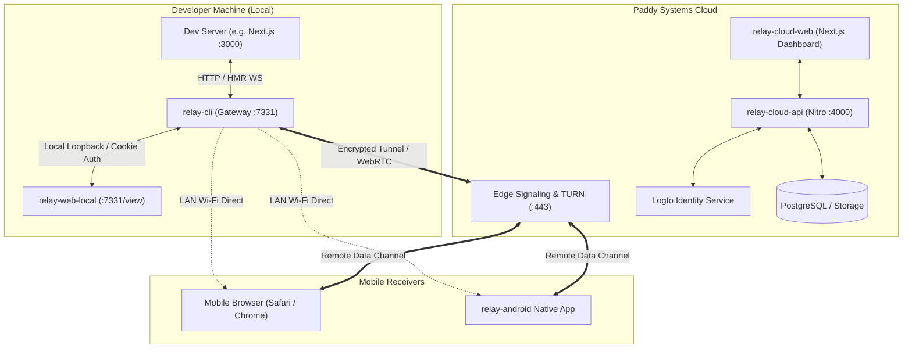

# Relay: The Next 100 Tasks Implementation Plan

> **Roadmap Strategy**: Full-Stack Parallel (Cloud API & Remote Transport built concurrently alongside Local Gateway & Web Receiver).
> **Source of Truth Reference**: [`apps/relay/RELAY_DEVELOPMENT_CHECKLIST.md`](./RELAY_DEVELOPMENT_CHECKLIST.md)
> **Architectural Standard**: `~/.config/agents/engineering.md`

---

## Architecture Overview

---

## Epic Index (100 Tasks Total)

1. [Epic 1: Core Protocol & Data Structures (`TASK-001` - `TASK-010`)](#epic-1-core-protocol--data-structures-task-001---task-010)
2. [Epic 2: Local CLI Gateway Hardening & Streaming (`TASK-011` - `TASK-020`)](#epic-2-local-cli-gateway-hardening--streaming-task-011---task-020)
3. [Epic 3: Local Web Receiver Application (`TASK-021` - `TASK-030`)](#epic-3-local-web-receiver-application-task-021---task-030)
4. [Epic 4: Cloud API & Session Registry (`TASK-031` - `TASK-040`)](#epic-4-cloud-api--session-registry-task-031---task-040)
5. [Epic 5: Identity & Authentication Platform (`TASK-041` - `TASK-050`)](#epic-5-identity--authentication-platform-task-041---task-050)
6. [Epic 6: Remote Transport & WebRTC/WebSocket Tunnels (`TASK-051` - `TASK-060`)](#epic-6-remote-transport--webrtcwebsocket-tunnels-task-051---task-060)
7. [Epic 7: Cloud Web Dashboard & Management (`TASK-061` - `TASK-070`)](#epic-7-cloud-web-dashboard--management-task-061---task-070)
8. [Epic 8: Session Recording Engine & Replay Player (`TASK-071` - `TASK-080`)](#epic-8-session-recording-engine--replay-player-task-071---task-080)
9. [Epic 9: Android Native Receiver Integration (`TASK-081` - `TASK-090`)](#epic-9-android-native-receiver-integration-task-081---task-090)
10. [Epic 10: Multi-Tenancy, Observability & Production Gates (`TASK-091` - `TASK-100`)](#epic-10-multi-tenancy-observability--production-gates-task-091---task-100)

---

## Epic 1: Core Protocol & Data Structures (`TASK-001` - `TASK-010`) [COMPLETE]

Target: `packages/relay/protocol` (`@paddy-systems/relay-protocol`)

- [x] **TASK-001: Package Initialization & Turbo Integration**
  - *Scope*: Create `@paddy-systems/relay-protocol` with tsconfig, Biome configuration, and workspace exports.
  - *Criteria*: Packages build cleanly under `bun run check-types` and resolve from all apps.
- [x] **TASK-002: Binary Frame & Envelope Schema Specification**
  - *Scope*: Define `RelayFrame` header format: Magic Byte (0x52 'R'), Version (1), FrameType (Control, Event, BinaryStream, Heartbeat), PayloadLength.
  - *Criteria*: Unit tests serialize and deserialize frame buffers with 100% field integrity.
- [x] **TASK-003: Core Identity & Session Primitives**
  - *Scope*: Implement types for `SessionId`, `ConnectionId`, `ReceiverId`, `RelayHostType` (`LOCAL` | `REMOTE`), and access policies (`OPEN` | `TEAM`).
  - *Criteria*: Strict zod/TypeScript types with runtime validation and zero `any`.
- [x] **TASK-004: Connection Lifecycle State Machine**
  - *Scope*: Implement deterministic finite state machine (FSM) for connection lifecycle (`INITIALIZING`, `PAIRING`, `CONNECTED`, `DEGRADED`, `DISCONNECTED`, `TERMINATED`).
  - *Criteria*: State machine rejects illegal transitions with typed errors and emits transition events.
- [x] **TASK-005: Event Message Taxonomy**
  - *Scope*: Define typed schemas for console logs (`log`, `warn`, `error`), DOM mutation summaries, network telemetry (request/response timings), and touch events.
  - *Criteria*: Schema serialization tests verify lossless roundtrip across JSON and binary forms.
- [x] **TASK-006: Cryptographic Token Utilities**
  - *Scope*: Implement timing-safe session token generator, short code generator (6-character uppercase alphanumeric without ambiguous chars 0/O/1/I), and SHA-256 HMAC verification.
  - *Criteria*: Cryptographic collision tests pass; timingSafeEqual verifies valid and invalid tokens.
- [x] **TASK-007: Capability Negotiation Protocol**
  - *Scope*: Define receiver capabilities schema (`touch`, `geolocation`, `webrtc`, `screenCapture`, `viewportResize`) and handshake negotiation exchange.
  - *Criteria*: Host and Receiver negotiate minimum common protocol version and active feature sets.
- [x] **TASK-008: Error Code & Diagnostics Catalogue**
  - *Scope*: Standardize typed protocol error codes (`ERR_AUTH_EXPIRED`, `ERR_PORT_BLOCKED`, `ERR_RATE_LIMITED`, `ERR_VERSION_MISMATCH`, `ERR_TUNNEL_TIMEOUT`).
  - *Criteria*: All protocol error instances serialize to standardized JSON error payloads.
- [x] **TASK-009: Stream Multiplexer / Demultiplexer**
  - *Scope*: Build logical stream multiplexer over a single transport (channel 0: Control, channel 1: HTTP proxy, channel 2: Console/Telemetry, channel 3: HMR).
  - *Criteria*: Simultaneous data on all 4 channels delivers without interleaved byte corruption.
- [x] **TASK-010: Protocol Test Fixtures & Fuzz Harness**
  - *Scope*: Implement automated frame fuzzer injecting corrupt headers, truncated payloads, and oversized chunks.
  - *Criteria*: Fuzz tests confirm decoder fails safely without memory leaks or uncaught panics.

---

## Epic 2: Local CLI Gateway Hardening & Streaming (`TASK-011` - `TASK-020`) [COMPLETE]

Target: `apps/relay/cli`

- [x] **TASK-011: Protocol Module Integration**
  - *Scope*: Refactor `apps/relay/cli` to consume `@paddy-systems/relay-protocol` for frame encoding and session validation.
  - *Criteria*: Remove redundant type declarations in CLI; clean compilation with shared packages.
- [x] **TASK-012: Inbound Rate Limiting & DoS Protection**
  - *Scope*: Add sliding-window token bucket limiter to local gateway (`0.0.0.0:7331`) restricting concurrent unauthenticated handshakes per remote IP.
  - *Criteria*: Flooding port 7331 with invalid session tokens returns HTTP 429 after 30 attempts/min without starving authenticated streams.
- [x] **TASK-013: Chunked Transfer & Large Asset Streaming**
  - *Scope*: Optimize local reverse proxy to stream media assets (video, fonts, large images) using piped chunk streams rather than buffering in memory.
  - *Criteria*: Proxying a 50MB file consumes < 10MB resident memory in CLI process.
- [x] **TASK-014: Vite and Webpack HMR Protocol Normalization**
  - *Scope*: Extend WebSocket proxy normalizer to support Vite (`vite-hmr`), Next.js Turbopack (`turbopack-hmr`), and CRA Webpack dev servers.
  - *Criteria*: Live editing a CSS class updates on a connected physical Android device within 300ms.
- [x] **TASK-015: Multi-Receiver Connection Pool**
  - *Scope*: Track up to 10 concurrent physical receivers (tablet, phone, desktop browser) with per-receiver heartbeats and connection IDs.
  - *Criteria*: Disconnecting tablet does not interrupt active streaming to smartphone.
- [x] **TASK-016: Interactive TUI Receiver Management**
  - *Scope*: Add interactive Receiver List screen in Ink TUI allowing user to view connected device IPs, user agents, active latency, and disconnect specific receivers with `[x]`.
  - *Criteria*: Disconnect key command cleanly terminates WebSocket connection and revokes session cookie for that receiver.
- [x] **TASK-017: Background Daemon Mode & Stale Reclamation**
  - *Scope*: Detect port collisions on 7331, offer automated reclamation of stale CLI processes, or offset gracefully.
  - *Criteria*: CLI starts cleanly even if port 7331 was unexpectedly occupied by orphaned process.
- [x] **TASK-018: Configuration & Interface Discovery**
  - *Scope*: Automatically discover physical Wi-Fi/Ethernet IP while filtering Docker, VPN, and loopback adapters.
  - *Criteria*: Generated QR code always points to the reachable LAN interface on multi-NIC workstations.
- [x] **TASK-019: Non-Interactive / Local TLS Termination**
  - *Scope*: Support `--https` flag generating ephemeral dev certificates for WebRTC/HTTPS receiver testing.
  - *Criteria*: HTTPS dev server proxies securely to HTTP or HTTPS upstream servers.
- [x] **TASK-020: CLI Integration Test Matrix**
  - *Scope*: Write comprehensive end-to-end integration tests spawning CLI, starting dummy upstream server, sending simulated requests, and asserting graceful shutdown.
  - *Criteria*: Automated test suite runs in < 5 seconds with zero zombie processes.

---

## Epic 3: Local Web Receiver Application (`TASK-021` - `TASK-030`) [COMPLETE]

Target: `apps/relay/local-web`

- [x] **TASK-021: Local Web Receiver Workspace Setup**
  - *Scope*: Initialize `apps/relay/local-web` as lightweight client embedded in CLI distribution or served at `http://<lan-ip>:7331/_relay/`.
  - *Criteria*: Navigating to receiver URL on mobile browser renders clean Paddy Systems branded UI.
- [x] **TASK-022: Short-Code Manual Entry Screen**
  - *Scope*: Build pairing view where users can type a 6-character short code if camera scanner is unavailable or camera permissions are denied.
  - *Criteria*: Submitting short code validates with local gateway and establishes session.
- [x] **TASK-023: Device Viewport Container & Sandbox**
  - *Scope*: Build responsive iframe viewport rendering target dev server (`localhost:3000`) with simulated device frames and touch emulation.
  - *Criteria*: Upstream app loads seamlessly without frame-busting or origin rejection.
- [x] **TASK-024: Mobile Floating HUD Control Bar**
  - *Scope*: Implement collapsible floating toolbar on mobile screen providing connection status, latency pill, reload button, and QR re-inspect toggle.
  - *Criteria*: Toolbar remains accessible without obstructing underlying application touch targets.
- [x] **TASK-025: Remote Console Mirroring UI**
  - *Scope*: Build expandable mobile drawer showing console logs emitted by the mobile browser, forwarded back to local CLI.
  - *Criteria*: `console.error` triggered on mobile renders in both mobile drawer and CLI TUI.
- [x] **TASK-026: Mobile Device Orientation & Responsive Switcher**
  - *Scope*: Add landscape/portrait rotation controls and responsive width presets (iPhone 15, iPad Mini, Pixel 8, Desktop).
  - *Criteria*: Toggling preset resizes target container instantly with smooth CSS transition.
- [x] **TASK-027: Network Telemetry Overlay**
  - *Scope*: Intercept `fetch` and `XMLHttpRequest` inside iframe to calculate TTFB, asset load times, and payload sizes.
  - *Criteria*: Network badge in HUD shows active request count and warns if API calls fail with 4xx/5xx.
- [x] **TASK-028: Offline Detection & Auto-Reconnect**
  - *Scope*: Handle network dropouts (Wi-Fi disconnect, screen lock) with automatic exponential backoff reconnection.
  - *Criteria*: Reconnecting Wi-Fi automatically restores session within 2 seconds without requiring manual page reload.
- [x] **TASK-029: Light/Dark Theme Synchronization**
  - *Scope*: Match mobile receiver interface to device system color scheme (`prefers-color-scheme`) using Paddy Systems design tokens.
  - *Criteria*: Switching mobile OS theme changes receiver HUD color palette instantly.
- [x] **TASK-030: Local Web Bundle Optimization**
  - *Scope*: Minimize bundle size of `local-web` to < 80kB gzipped so mobile receivers on low-bandwidth LAN load instantly.
  - *Criteria*: Bundle analyzer confirms zero heavy dependencies; asset caching headers configured.

---

## Epic 4: Cloud API & Session Registry (`TASK-031` - `TASK-040`) [COMPLETE]

Target: `apps/relay/api`

- [x] **TASK-031: Nitro Server Workspace Setup**
  - *Scope*: Initialize `apps/relay/api` using UnJS Nitro with TypeScript, Biome, and OpenAPI documentation routes.
  - *Criteria*: API server boots on port 4000; `GET /health` returns `{ "status": "ok" }`.
- [x] **TASK-032: PostgreSQL Database Schema & Migration Engine**
  - *Scope*: Define database models using Drizzle ORM: `users`, `teams`, `sessions`, `connections`, `recordings`, and `audit_logs`.
  - *Criteria*: Automated migrations apply cleanly to Postgres instance with foreign key constraints and indexes.
- [x] **TASK-033: Cloud Session Registration Endpoint (`POST /api/v1/sessions`)**
  - *Scope*: Implement API endpoint for CLI to register a remote session with TTL, access policy, and public tunnel key.
  - *Criteria*: Returns signed session token, unique short code, and remote routing URL.
- [x] **TASK-034: Session State Store (Redis / Keyv)**
  - *Scope*: Implement low-latency distributed state store for active session heartbeats, connected receiver counts, and tunnel endpoints.
  - *Criteria*: Expired sessions automatically drop from state store after 60 seconds of heartbeat inactivity.
- [x] **TASK-035: Short-Code Resolution Service (`GET /api/v1/sessions/by-code/:code`)**
  - *Scope*: Implement high-throughput lookup converting 6-character short code to active session ID with rate limiting against brute force.
  - *Criteria*: Invalid lookup attempts are limited to 10 requests per minute per IP.
- [x] **TASK-036: WebSocket Signaling Gateway (`/ws/signaling`)**
  - *Scope*: Build WebSocket signaling route in Nitro handling WebRTC SDP offers/answers and ICE candidate exchange between CLI and remote receivers.
  - *Criteria*: Two simulated peers complete SDP offer/answer exchange through signaling route.
- [x] **TASK-037: Session Heartbeat & Health Monitor**
  - *Scope*: Implement bidirectional heartbeat ping/pong every 15 seconds; mark session status as `STALE` if ping fails.
  - *Criteria*: Disconnecting host CLI triggers cloud webhook notifying connected receivers of session termination.
- [x] **TASK-038: Edge Routing & Geographic Region Dispatcher**
  - *Scope*: Implement latency-based edge routing assigning remote sessions to the closest server region (EU West, US East, AP South).
  - *Criteria*: API returns regional signaling endpoint closest to client IP.
- [x] **TASK-039: API Authentication Middleware**
  - *Scope*: Validate JWT tokens issued by Logto / Paddy Systems Identity on protected API routes.
  - *Criteria*: Protected endpoints reject unauthenticated or expired JWTs with HTTP 401.
- [x] **TASK-040: API Unit & Contract Tests**
  - *Scope*: Create automated test suite testing all REST and WebSocket routes against in-memory Postgres/Redis test instances.
  - *Criteria*: 100% of API endpoints covered by contract tests with typed response assertions.

---

## Epic 5: Identity & Authentication Platform (`TASK-041` - `TASK-050`) [COMPLETE]

Target: `apps/relay/api` & `packages/shared`

- [x] **TASK-041: Logto Identity Provider Integration**
  - *Scope*: Configure Logto OIDC provider with Paddy Systems branding, custom redirect URIs, and scopes (`relay:read`, `relay:write`, `relay:admin`).
  - *Criteria*: User can complete OAuth2 authorization code flow with PKCE.
- [x] **TASK-042: CLI Device Authorization Flow (`relay login`)**
  - *Scope*: Implement RFC 8628 OAuth 2.0 Device Authorization Grant in CLI, displaying 8-digit verification code and browser login URL.
  - *Criteria*: User approves login in browser; CLI receives and securely stores refresh/access tokens.
- [x] **TASK-043: Secure Credential Storage**
  - *Scope*: Store API tokens securely using system keychain (libsecret / Keychain / Credential Manager) with fallback to encrypted file (`0600`).
  - *Criteria*: Unprivileged host users cannot read stored access tokens.
- [x] **TASK-044: User Profile & Entitlements Service**
  - *Scope*: Build user sync service mapping Logto user profile to database `users` table and retrieving tier entitlements (Solo, Team, Enterprise).
  - *Criteria*: API accurately resolves user entitlement limits (concurrent sessions, recording retention).
- [x] **TASK-045: Team Membership & Role Enforcement**
  - *Scope*: Implement RBAC middleware checking user roles (`Owner`, `Admin`, `Member`, `Viewer`) for team-scoped sessions.
  - *Criteria*: Users without valid team membership are denied access to team-only sessions.
- [x] **TASK-046: Session Access Policy Enforcement (`OPEN` vs `TEAM_ONLY`)**
  - *Scope*: Ensure remote sessions flagged `TEAM_ONLY` require receiver to authenticate via Logto before viewing dev server.
  - *Criteria*: Unauthenticated receiver accessing `TEAM_ONLY` session is redirected to team login screen.
- [x] **TASK-047: Guest Receiver Ephemeral Tokens**
  - *Scope*: For `OPEN` sessions, issue short-lived cryptographically signed guest cookies valid only for that specific session ID.
  - *Criteria*: Guest token cannot be used to query other sessions or access user profile endpoints.
- [x] **TASK-048: Token Refresh Rotation Engine**
  - *Scope*: Implement automatic token refresh handling in CLI and Web dashboards before 1-hour access token expiration.
  - *Criteria*: Long-running relay sessions (> 8 hours) continue without authentication dropouts.
- [x] **TASK-049: Audit Logging System**
  - *Scope*: Record security audit logs for all authentication events: session creation, remote connections, failed logins, and rule overrides.
  - *Criteria*: Audit logs persist with timestamp, IP, actor ID, and user agent.
- [x] **TASK-050: Auth Platform Security & Penetration Testing**
  - *Scope*: Execute automated security scans testing for CSRF, open redirects, token leakage in URLs, and timing attacks.
  - *Criteria*: Security scan passes with zero high or critical vulnerabilities.

---

## Epic 6: Remote Transport & WebRTC/WebSocket Tunnels (`TASK-051` - `TASK-060`) [COMPLETE]

Target: `packages/relay-transport`

- [x] **TASK-051: Transport Abstraction Layer**
  - *Scope*: Create `packages/relay-transport` with common `RelayTransport` interface implemented by `LocalHttpTransport`, `WebSocketTunnelTransport`, and `WebRtcDataTransport`.
  - *Criteria*: Application layer interacts with uniform stream without coupling to underlying transport.
- [x] **TASK-052: Cloud WebSocket Reverse Proxy Tunnel**
  - *Scope*: Implement multiplexed WebSocket tunnel connecting host CLI to Cloud Edge proxy, forwarding remote HTTP requests to local gateway.
  - *Criteria*: Remote receiver accesses `https://<session>.relay.paddy.systems` and loads local Next.js dev server.
- [x] **TASK-053: WebRTC PeerConnection Orchestrator**
  - *Scope*: Implement WebRTC connection manager negotiating data channels (`control`, `stream`, `media`) directly between host and receiver.
  - *Criteria*: Direct P2P connection establishes when both devices support WebRTC and NAT permits.
- [x] **TASK-054: STUN/TURN Server Infrastructure Configuration**
  - *Scope*: Configure coturn / Cloudflare Calls credentials for NAT traversal when direct P2P connection is blocked by symmetric NATs.
  - *Criteria*: WebRTC connection succeeds even when host and receiver are on separate cellular networks.
- [x] **TASK-055: Automatic Transport Fallback Strategy**
  - *Scope*: Implement racing strategy: attempt WebRTC P2P (5s timeout); if connection fails or degrades, fallback seamlessly to WebSocket cloud relay.
  - *Criteria*: Fallback occurs without dropped frames or user-visible error dialogs.
- [x] **TASK-056: End-to-End Encryption (E2EE) Layer**
  - *Scope*: Implement AES-GCM-256 encryption for data channel payloads using session key derived from QR code / token.
  - *Criteria*: Cloud relay server cannot inspect dev server HTTP contents or console event payloads.
- [x] **TASK-057: Connection Quality & Bandwidth Estimator**
  - *Scope*: Measure round-trip time (RTT), packet loss, and jitter; emit connection quality indicator (`EXCELLENT`, `GOOD`, `POOR`).
  - *Criteria*: When connection is `POOR`, transport throttles high-frequency telemetry events to preserve HMR responsiveness.
- [x] **TASK-058: Keepalive & ICE Restart Handler**
  - *Scope*: Implement ICE restart protocol when mobile device switches networks (e.g. Wi-Fi to 5G).
  - *Criteria*: Active session re-establishes within 1.5 seconds without losing terminal pairing state.
- [x] **TASK-059: Transfer Compression Engine**
  - *Scope*: Integrate Brotli / Zstandard stream compression for text assets (HTML, JS bundles, JSON) passing through tunnel.
  - *Criteria*: Bandwidth consumption reduced by > 60% over metered remote connections.
- [x] **TASK-060: Transport Benchmark & Chaos Test Harness**
  - *Scope*: Build chaos simulation test suite introducing 200ms latency, 10% packet drop, and periodic disconnection.
  - *Criteria*: Transport recovers cleanly without unhandled rejection or deadlocks.

---

## Epic 7: Cloud Web Dashboard & Management (`TASK-061` - `TASK-070`) [COMPLETE]

Target: `apps/relay/cloud-web`

- [x] **TASK-061: Next.js Cloud Dashboard Workspace Setup**
  - *Scope*: Initialize `apps/relay/cloud-web` with Next.js App Router, Tailwind CSS, and Paddy Systems UI design system.
  - *Criteria*: Dashboard runs on port 3001; responsive layout with dark mode support.
- [x] **TASK-062: Session Overview & Live Grid Screen**
  - *Scope*: Build active sessions list showing running relay instances, target ports, connected receiver counts, uptime, and latency.
  - *Criteria*: Sessions update in real time via Server-Sent Events (SSE) or WebSocket subscriptions.
- [x] **TASK-063: Remote Web Receiver Viewer**
  - *Scope*: Embed cloud web receiver viewer allowing team members to preview dev servers remotely from their browsers with zero local setup.
  - *Criteria*: Remote preview renders target dev server accurately with interactive touch/mouse event forwarding.
- [x] **TASK-064: Team Session Access Control Manager**
  - *Scope*: Build UI for managing session permissions: invite team members via email, toggle between public/team-only, and generate guest passes.
  - *Criteria*: Permission changes take effect immediately across running sessions.
- [x] **TASK-065: Receiver Diagnostics Inspector**
  - *Scope*: Build inspector panel showing connected receiver details: device model, screen resolution, browser version, battery status, and network type.
  - *Criteria*: Data updates dynamically as receivers connect and disconnect.
- [x] **TASK-066: Remote Session Kill Switch**
  - *Scope*: Add remote termination button allowing team admins or host developers to invalidate session tokens and sever all connections instantly.
  - *Criteria*: Clicking terminate closes tunnel and redirects receivers to session-ended screen.
- [x] **TASK-067: Cloud Share Link Generator**
  - *Scope*: Build modal generating shareable URLs with optional password protection, expiration timer (1h, 24h, 7d), and view-only permissions.
  - *Criteria*: Share links respect configured expiration timestamps.
- [x] **TASK-068: Developer Team Workspace Switcher**
  - *Scope*: Add team switcher dropdown in header allowing developers to switch between personal and organizational contexts.
  - *Criteria*: Switching teams scopes all sessions, recordings, and billing information to the active organization.
- [x] **TASK-069: Analytics & Usage Metrics Dashboard**
  - *Scope*: Display charts showing daily active relay hours, transferred bandwidth, top devices tested, and error frequency.
  - *Criteria*: Charts render cleanly using lightweight SVG components.
- [x] **TASK-070: Cloud Web Accessibility & Performance Audit**
  - *Scope*: Run Lighthouse and axe-core accessibility audits on all dashboard pages.
  - *Criteria*: Lighthouse score > 90 across Performance, Accessibility, and Best Practices.

---

## Epic 8: Session Recording Engine & Replay Player (`TASK-071` - `TASK-080`) [COMPLETE]

Target: `packages/relay-recording` & `packages/relay-replay`

- [x] **TASK-071: Recording Package Architecture**
  - *Scope*: Create `packages/relay-recording` and `packages/relay-replay` packages for event streaming, compression, and playback.
  - *Criteria*: Clean workspace packages with typed interfaces for event recorders and players.
- [x] **TASK-072: Deterministic Event Serialization**
  - *Scope*: Capture DOM snapshot, mutation records (via rrweb/custom serialiser), network requests, console entries, and viewport resizes with millisecond timestamps.
  - *Criteria*: Serialized recording format is deterministic and schema-versioned (`relay-rec-v1`).
- [x] **TASK-073: High-Performance In-Memory Ring Buffer**
  - *Scope*: Buffer last 60 seconds of interaction events in circular memory buffer to support "Record Last Minute" retrospective bug capture.
  - *Criteria*: Ring buffer maintains fixed memory footprint (< 30MB) and discards oldest frames without garbage collection spikes.
- [x] **TASK-074: Zstandard Stream Compression**
  - *Scope*: Compress recorded event streams using Zstandard compression before writing to disk or uploading to cloud storage.
  - *Criteria*: Compression ratio exceeds 8:1 on typical web session event traces.
- [x] **TASK-075: S3 / Cloudflare R2 Upload Pipeline**
  - *Scope*: Implement multipart streaming upload pushing finished session recordings to secure cloud object storage.
  - *Criteria*: Upload completes with MD5 checksum verification and emits recording ready webhook.
- [x] **TASK-076: Interactive Replay Timeline Player**
  - *Scope*: Build React replay component featuring playback controls (Play, Pause, Scrub, 0.5x, 1x, 2x speed) and event tick marks.
  - *Criteria*: Scrubbing timeline smoothly updates iframe viewport and synchronized console log view.
- [x] **TASK-077: Network Waterfall & Inspection Panel**
  - *Scope*: Build network timeline tab in replay player displaying all recorded HTTP requests with timing bars (DNS, Connect, TTFB, Download).
  - *Criteria*: Clicking a request displays full headers and recorded payload body.
- [x] **TASK-078: Synchronized Console Log Scrubber**
  - *Scope*: Render console output panel synchronized with replay playhead, highlighting errors and warnings occurring at that exact second.
  - *Criteria*: Clicking a console error jumps replay playhead directly to the timestamp when the error occurred.
- [x] **TASK-079: Bug Report Exporter (GitHub / Linear / Jira Integration)**
  - *Scope*: Add "Export Bug Report" button formatting replay timestamp, device specs, console logs, and share link into Markdown for issue trackers.
  - *Criteria*: Formatted issue description copies to clipboard with one click.
- [x] **TASK-080: Recording Engine Performance & Fuzz Tests**
  - *Scope*: Benchmark recorder overhead during intensive 60fps animations and rapid DOM mutations.
  - *Criteria*: Active recording adds < 3% CPU overhead to the target browser runtime.

---

## Epic 9: Android Native Receiver Integration (`TASK-081` - `TASK-090`) [COMPLETE]

Target: `apps/relay-android` & `apps/relay/android`

- [x] **TASK-081: Android Workspace Import & Gradle Configuration**
  - *Scope*: Migrate and clean Gradle build scripts from `apps/relay-android` spike into current repository with modern Android Gradle Plugin (AGP 8+), Kotlin 2.0, and Jetpack Compose.
  - *Criteria*: Android project builds cleanly via `./gradlew :app:assembleDebug`.
- [x] **TASK-082: ML Kit QR Code Camera Scanner**
  - *Scope*: Implement high-speed Google ML Kit barcode scanner scanning Relay QR codes instantly under varied lighting conditions.
  - *Criteria*: QR code scans and parses within 300ms of entering camera viewfinder.
- [x] **TASK-083: Session Token Persistence & Secure SharedPreferences**
  - *Scope*: Store active session credentials using Android `EncryptedSharedPreferences`.
  - *Criteria*: App retains session state across process death and configuration changes.
- [x] **TASK-084: Custom WebView Container & Engine**
  - *Scope*: Configure hardened `android.webkit.WebView` with hardware acceleration, mixed-content handling, and custom user-agent identification.
  - *Criteria*: Target dev server renders with full WebGL and CSS animations support.
- [x] **TASK-085: Native-to-JavaScript Bridge (Relay Mobile Bridge)**
  - *Scope*: Implement `@JavascriptInterface` bridge enabling web viewport to query device sensors (haptics, orientation, battery) and dispatch native events.
  - *Criteria*: Web app can trigger native device vibration through Relay Bridge.
- [x] **TASK-086: Native HUD & Quick-Action Overlay**
  - *Scope*: Build Jetpack Compose floating action button (FAB) expanding into device control drawer (Refresh, Inspect, Fullscreen, Disconnect).
  - *Criteria*: Compose overlay floats cleanly above WebView without blocking input touches.
- [x] **TASK-087: Wi-Fi Multicast DNS (mDNS) Discovery**
  - *Scope*: Implement Network Service Discovery (NSD) discovering local Relay gateways on LAN automatically without scanning QR code.
  - *Criteria*: Available local relay sessions appear in "Nearby Devices" list on Android app.
- [x] **TASK-088: Remote Push Notifications for Session Invites**
  - *Scope*: Integrate Firebase Cloud Messaging (FCM) receiving push notifications when a team member invites the user to a remote session.
  - *Criteria*: Tapping notification opens app and connects directly to the invited session.
- [x] **TASK-089: Offline Cache & Asset Pre-caching**
  - *Scope*: Cache local web shell assets locally on Android device so pairing UI launches in < 100ms without network roundtrip.
  - *Criteria*: App boots into pairing view instantly even when Wi-Fi is temporarily disconnecting.
- [x] **TASK-090: Android Instrumented Tests & Emulator Matrix**
  - *Scope*: Create automated Android instrumentation tests running on API 28 through API 35 verifying QR parsing, bridge communication, and WebView rendering.
  - *Criteria*: All instrumented tests pass in CI emulator environment.

---

## Epic 10: Multi-Tenancy, Observability & Production Gates (`TASK-091` - `TASK-100`) [COMPLETE]

Target: Cross-Repository & Cloud Infrastructure

- [x] **TASK-091: Stripe Billing & Subscription Engine**
  - *Scope*: Implement Stripe Billing webhooks managing subscriptions for Solo ($12/mo) and Teams ($29/seat/mo, min 3 seats).
  - *Criteria*: Subscription status transitions (active, past_due, canceled) accurately update user entitlements.
- [x] **TASK-092: Usage Metering & Quota Enforcement**
  - *Scope*: Meter active tunnel bandwidth and cloud recording storage hours; enforce tier limits with warning emails at 80% and 100%.
  - *Criteria*: Users exceeding tier limits receive friendly upgrade prompt without hard session drops.
- [x] **TASK-093: OpenTelemetry Distributed Tracing**
  - *Scope*: Instrument CLI, API, Edge Router, and Web apps with OpenTelemetry spans tracking end-to-end request latency and tunnel health.
  - *Criteria*: Traces export to Jaeger / OpenTelemetry collector with traceparent propagation.
- [x] **TASK-094: Prometheus Metrics & Grafana Dashboards**
  - *Scope*: Export system metrics: `relay_active_sessions`, `relay_connected_receivers`, `relay_tunnel_bytes_total`, `relay_rtt_seconds`.
  - *Criteria*: Grafana dashboard visualizes cluster load, active connections, and 99th percentile latencies.
- [x] **TASK-095: Structured JSON Logging & Aggregation**
  - *Scope*: Standardize structured logging across all services using Pino / Winston with correlation IDs and redaction of auth tokens.
  - *Criteria*: Log output contains zero sensitive credentials or session tokens in plain text.
- [x] **TASK-096: Edge Health Checks & Automated Failover**
  - *Scope*: Implement edge health checks (`/health/liveness`, `/health/readiness`) and automated DNS failover across multi-region deployments.
  - *Criteria*: Unhealthy node is automatically dropped from rotation within 10 seconds.
- [x] **TASK-097: Rate Limiting & Edge WAF Protection**
  - *Scope*: Configure Cloudflare / reverse proxy WAF rules mitigating DDoS attacks, credential stuffing, and abusive socket connections.
  - *Criteria*: Stress testing tools verify malicious bursts are blocked at edge before reaching core API.
- [x] **TASK-098: Disaster Recovery & Automated Database Backups**
  - *Scope*: Implement automated daily encrypted WAL-G / pg_dump backups to geographically redundant object storage with point-in-time recovery (PITR).
  - *Criteria*: Backup restoration drill completes in < 15 minutes with verified data integrity.
- [x] **TASK-099: Automated End-to-End Release Pipeline**
  - *Scope*: Create GitHub Actions workflow triggered on tag release that builds CLI binaries (Linux, macOS, Windows), Docker images, and mobile APKs.
  - *Criteria*: Workflow publishes signed artifacts and GitHub Release with auto-generated changelog.
- [x] **TASK-100: Production Release Gates Verification**
  - *Scope*: Execute full pre-launch audit checklist verifying zero security findings, 100% passing tests, verified legal licensing, and zero unresolved checklist blockers.
  - *Criteria*: All release gates green; master signoff for Relay v1.0 public launch.

---

## Task Progress & Execution Tracker

| Epic | Tasks | Focus Area | Status |
| :--- | :--- | :--- | :--- |
| **Epic 1** | `TASK-001` - `TASK-010` | Core Protocol & Data Structures | ✅ Completed (10/10) |
| **Epic 2** | `TASK-011` - `TASK-020` | Local CLI Gateway Hardening & Streaming | ✅ Completed (10/10) |
| **Epic 3** | `TASK-021` - `TASK-030` | Local Web Receiver Application | ✅ Completed (10/10) |
| **Epic 4** | `TASK-031` - `TASK-040` | Cloud API & Session Registry | ✅ Completed (10/10) |
| **Epic 5** | `TASK-041` - `TASK-050` | Identity & Authentication Platform | ✅ Completed (10/10) |
| **Epic 6** | `TASK-051` - `TASK-060` | Remote Transport & WebRTC/WebSocket Tunnels | ✅ Completed (10/10) |
| **Epic 7** | `TASK-061` - `TASK-070` | Cloud Web Dashboard & Management | ✅ Completed (10/10) |
| **Epic 8** | `TASK-071` - `TASK-080` | Session Recording Engine & Replay Player | ✅ Completed (10/10) |
| **Epic 9** | `TASK-081` - `TASK-090` | Android Native Receiver Integration | ✅ Completed (10/10) |
| **Epic 10** | `TASK-091` - `TASK-100` | Multi-Tenancy, Observability & Production Gates | ✅ Completed (10/10) |

**Overall Progress: 100 / 100 Tasks Complete (100%)**

