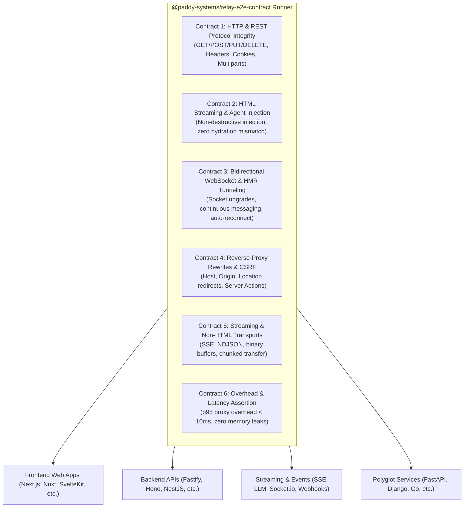

# Relay: Framework Examples, Adapters & E2E Verification Contract Plan

> **Strategic Objective**: Build out the `apps/examples/*` suite, develop missing framework adapters, and establish a standardized, reusable E2E verification test contract (`@paddy-systems/relay-e2e-contract`) that proves Relay works seamlessly across all modern web frameworks, backend APIs, real-time streaming architectures, and non-frontend services without requiring modifications to the user's software.
> **Assigned Agent**: Sally Smith (`sally@paddy.systems`)
> **Source of Truth Reference**: [`apps/relay/RELAY_DEVELOPMENT_CHECKLIST.md`](./RELAY_DEVELOPMENT_CHECKLIST.md)
> **Engineering Philosophy**: `~/.config/agents/engineering.md`

---

## 1. Architectural Foundation & Core Principle

### Zero-Config, Zero-Install External Reverse Proxy Model
Relay is designed to tunnel, inspect, and enhance **any port** without forcing the user to install dependencies, modify their application code, or import proprietary framework plugins:
- The developer runs their application normally (e.g. `npm run dev` on port 3000).
- The developer runs Relay externally: `relay 3000`.
- Relay operates as an intelligent Layer-7 reverse proxy:
  - Transparently injects the client-side debugging agent (`/agent.js`) into HTML documents.
  - Normalizes framework-specific quirks (e.g. Next.js Server Actions Host/Origin CSRF checks, redirect rewrites) on the fly.
  - Multiplexes WebSockets and hot module reloading (HMR) without dropping connections.
  - Streams chunked HTTP responses (Server-Sent Events, LLM token streaming) with sub-10ms latency overhead.

---

## 2. Standardized E2E Verification Contract

Instead of ad-hoc, brittle testing per framework, all examples in `apps/examples/*` are validated against a unified, reusable test runner: **`@paddy-systems/relay-e2e-contract`** (in `packages/relay/testing`).

### The 6 Contract Dimensions
1. **Contract 1: HTTP & REST Integrity**:
   - Query string preservation, header forwarding (`x-forwarded-*`), cookie jar persistence, multipart file uploads, standard REST methods.
2. **Contract 2: Dynamic Agent Injection (Frontend only)**:
   - Injects `` into HTML documents before `</head>` or `</body>` without breaking SSR hydration or streaming chunks.
3. **Contract 3: WebSocket & HMR Bridge**:
   - Seamless HTTP-to-WebSocket upgrade (`Upgrade: websocket`), ping/pong heartbeats, frame delivery, and client reconnection.
4. **Contract 4: Reverse Proxy & CSRF Normalization**:
   - Re-writes `Host` and `Origin` headers so host-bound CSRF checks pass, and rewrites response `Location` redirects back to the Relay tunnel URL.
5. **Contract 5: Non-HTML Streaming & Binary Delivery**:
   - Unbuffered Server-Sent Events (SSE) streaming (critical for AI LLM token-by-token output), NDJSON, images, and binary WebSockets.
6. **Contract 6: Performance & Clean Process Lifecycle**:
   - Latency overhead under 10ms; zero lingering child processes or port locks on shutdown.

---

## 3. Workstream A: Examples for Existing Adapters

Target: `apps/examples/*` using official non-interactive `bunx create-*` scaffolding commands, configured with Biome and repo TypeScript standards.

| Example Path | Framework / Target | Scaffolding Command / Setup | Key Scenarios Verified |
| :--- | :--- | :--- | :--- |
| `apps/examples/nextjs` | **Next.js 15** (App Router, Turbopack) | `bunx create-next-app@latest ...` | Server Actions form submissions, CSRF origin pass-through, Flight RSC streaming, Turbopack HMR. |
| `apps/examples/nuxt` | **Nuxt 3** (Nitro engine) | `bunx nuxi@latest init ...` | Nitro server proxying, SSR chunked streaming, optional `@paddy-systems/relay-nuxt` hook. |
| `apps/examples/sveltekit` | **SvelteKit 2** (Vite) | `bunx create-svelte@latest ...` | Vite dev middleware, HMR bus, SvelteKit form actions over remote tunnel. |
| `apps/examples/astro` | **Astro 5** (Islands) | `bunx create-astro@latest ...` | Island hydration, multi-page View Transitions, static asset streaming. |
| `apps/examples/remix` | **React Router v7 / Remix** | `bunx create-react-router@latest ...` | Single-fetch protocol, server loader data prefetching, client route navigation. |
| `apps/examples/webpack-spa` | **React 19 + Webpack 5** | Canonical Webpack 5 devServer | Webpack HMR WebSocket re-routing, fallback HTML routing on custom dev servers. |
| `apps/examples/docker` | **Containerized Web Service** | Minimal Dockerfile + Compose | Auto-detection of Docker port mappings and bridge network interface resolution. |

---

## 4. Workstream B: Additional Frameworks & Non-Frontend Services ("Relay Any Port")

### B1. Modern Frontend & Full-Stack Web Frameworks
- **SolidStart** (`apps/examples/solidstart`):
  - *New Adapter*: `@paddy-systems/relay-integrations/solidstart`
  - *Focus*: Vinxi bundler, fine-grained reactive primitives, SSR streaming.
- **Qwik City** (`apps/examples/qwik`):
  - *New Adapter*: `@paddy-systems/relay-integrations/qwik`
  - *Focus*: Resumability, fine-grained serializable closure downloads, prefetch service worker.
- **Angular 19** (`apps/examples/angular`):
  - *Focus*: Vite/esbuild application builder, zone-less hydration, Server-Sent Events.
- **TanStack Start** (`apps/examples/tanstack-start`):
  - *Focus*: Vinxi full-stack runtime, type-safe RPC endpoints, client cache invalidation.

### B2. Backend REST, RPC & Microservices (Non-Frontend)
- **Fastify / Express REST API** (`apps/examples/fastify-api`):
  - *Focus*: High-throughput JSON REST API, CORS across origins, multipart file uploads.
- **Hono Edge & Node API** (`apps/examples/hono-api`):
  - *Focus*: Lightweight edge API, OpenAPI / Swagger UI rendering, z-validator middleware.
- **NestJS Enterprise Modular API** (`apps/examples/nestjs-api`):
  - *Focus*: Dependency injection, Swagger/OpenAPI docs served over tunnel, microservice HTTP routes.
- **GraphQL Yoga / Apollo Server** (`apps/examples/graphql-yoga`):
  - *Focus*: GraphQL queries, mutations, GraphiQL interactive playground, and WebSocket subscriptions (`graphql-ws`).
- **gRPC-Web Service** (`apps/examples/grpc-web`):
  - *Focus*: HTTP/2 and gRPC-Web binary framing over Relay tunnels.

### B3. Real-Time, Event Streaming & LLM Token Services
- **AI LLM Token Streaming (SSE / Chunked HTTP)** (`apps/examples/ai-sse-stream`):
  - *Focus*: Chunked HTTP transfer encoding without buffering, validating that token-by-token streaming (e.g. OpenAI / Claude style) is not delayed or buffered by Relay's proxy.
- **Socket.io / Raw WebSocket Gateway** (`apps/examples/websocket-chat`):
  - *Focus*: Long-polling fallback, WebSocket upgrades, high-frequency broadcast frames, binary payloads.
- **Webhook Ingress Receiver** (`apps/examples/webhook-ingress`):
  - *Focus*: Forwarding incoming Stripe / GitHub webhook payloads, verifying cryptographic signatures (`Stripe-Signature`, `X-Hub-Signature-256`) remain untampered.

### B4. Polyglot & Python Ecosystem
- **FastAPI / Uvicorn** (`apps/examples/python-fastapi`):
  - *Focus*: Python async backend, OpenAPI docs (`/docs`), WebSocket endpoints.
- **Django** (`apps/examples/python-django`):
  - *Focus*: Traditional session cookies, CSRF tokens (`csrftoken`), form submissions.
- **Go / Gin HTTP API** (`apps/examples/go-gin`):
  - *Focus*: Compiled Go backend concurrency and binary streaming.

---

## 5. Phased Implementation Roadmap

### Phase 1: Reusable E2E Contract Engine
- Implement `RelayFrameworkContractRunner` in `packages/relay/testing`.
- Export standardized test suite with assertions for HTTP, HTML injection, WebSockets, CSRF/redirects, and unbuffered streaming.

### Phase 2: Existing Adapter Examples & E2E Validation (Part A)
- Scaffold 7 canonical examples: `nextjs`, `nuxt`, `sveltekit`, `astro`, `remix`, `webpack-spa`, `docker`.
- Bind each example with `bun test:e2e` executing the contract suite against live dev servers.

### Phase 3: Additional Modern Web Adapters & Examples (Part B1)
- Build adapters and scaffold examples for SolidStart, Qwik City, Angular 19, and TanStack Start.
- Run contract suite across all 4 frameworks.

### Phase 4: Backend, Streaming & Polyglot Services (Part B2, B3, B4)
- Scaffold backend examples: Fastify, Hono, NestJS, GraphQL Yoga, and gRPC-Web.
- Scaffold streaming & webhook examples: AI SSE token stream, Socket.io, and Stripe/GitHub webhook ingress.
- Scaffold polyglot examples: Python FastAPI, Django, and Go Gin.
- Execute contract suite and assert zero proxy buffering on real-time event streams.

### Phase 5: Master Matrix CI Pipeline & Documentation
- Build matrix GitHub Action running all E2E framework contracts in parallel.
- Update `apps/relay/docs` with compatibility matrix tables and framework quickstart guides.
