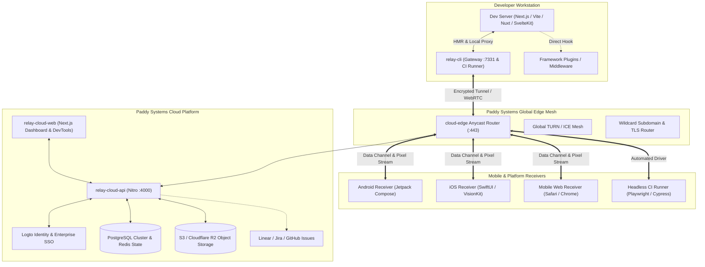

# Relay: Phase 2 Next 100 Tasks Implementation Plan

> **Roadmap Strategy**: Building upon Phase 1 Foundations (`PLAN_100_TASKS.md` and `PLAN_50_PARALLEL_TASKS.md`).
> **Source of Truth Reference**: [`apps/relay/RELAY_DEVELOPMENT_CHECKLIST.md`](./RELAY_DEVELOPMENT_CHECKLIST.md)
> **Architectural Standard**: `~/.config/agents/engineering.md`

---

## Architecture Evolution & Phase 2 Scope

---

## Epic Index (100 Tasks Total: `TASK-101` - `TASK-200`)

1. [Epic 11: Cloud Edge Routing & Tunnel Gateway Engine (`TASK-101` - `TASK-110`)](#epic-11-cloud-edge-routing--tunnel-gateway-engine-task-101---task-110)
2. [Epic 12: iOS Native Receiver Application (`TASK-111` - `TASK-120`)](#epic-12-ios-native-receiver-application-task-111---task-120)
3. [Epic 13: Framework Integration Ecosystem & Dev Server Plugins (`TASK-121` - `TASK-130`)](#epic-13-framework-integration-ecosystem--dev-server-plugins-task-121---task-130)
4. [Epic 14: Bi-Directional Interactive Remote Device Controls (`TASK-131` - `TASK-140`)](#epic-14-bi-directional-interactive-remote-device-controls-task-131---task-140)
5. [Epic 15: Deep Web Inspection, Storage & DevTools Integration (`TASK-141` - `TASK-150`)](#epic-15-deep-web-inspection-storage--devtools-integration-task-141---task-150)
6. [Epic 16: Physical Screen Capture & Media Streaming Engine (`TASK-151` - `TASK-160`)](#epic-16-physical-screen-capture--media-streaming-engine-task-151---task-160)
7. [Epic 17: Team Collaboration, Invites & Access Governance (`TASK-161` - `TASK-170`)](#epic-17-team-collaboration-invites--access-governance-task-161---task-170)
8. [Epic 18: Issue Tracker Integrations & Bug Workflow (`TASK-171` - `TASK-180`)](#epic-18-issue-tracker-integrations--bug-workflow-task-171---task-180)
9. [Epic 19: CI/CD Device Automation & Headless Testing Farm (`TASK-181` - `TASK-190`)](#epic-19-cicd-device-automation--headless-testing-farm-task-181---task-190)
10. [Epic 20: SRE, Enterprise Scale, Multi-Region & Production Hardening (`TASK-191` - `TASK-200`)](#epic-20-sre-enterprise-scale-multi-region--production-hardening-task-191---task-200)

---

## Epic 11: Cloud Edge Routing & Tunnel Gateway Engine (`TASK-101` - `TASK-110`)

Target: `apps/relay/cloud-edge` & `packages/relay/transport`

- [x] **TASK-101: Standalone Cloud Edge Service Scaffold**
  - *Scope*: Initialize `apps/relay/cloud-edge` as a high-performance HTTP/WebSocket reverse proxy and tunnel terminator built with TypeScript and Nitro/Node cluster.
  - *Criteria*: Service boots on edge ports 80/443; passes baseline health check; maintains separate worker pools for signaling vs data proxying.
- [x] **TASK-102: Wildcard Subdomain & SNI Dynamic Routing**
  - *Scope*: Implement Server Name Indication (SNI) router dynamically resolving incoming requests for `https://<session-id>.relay.paddy.systems` and directing traffic to the matching persistent host tunnel.
  - *Criteria*: Requests with unknown session subdomains return typed `ERR_SESSION_NOT_FOUND` HTML landing pages without socket hang-ups.
- [x] **TASK-103: Automated Let's Encrypt / ACME Dynamic TLS Provisioning**
  - *Scope*: Integrate automated ACME client on the edge for wildcard SSL/TLS certificate renewal and automated on-demand TLS for custom team subdomains (`*.team.relay.zone`).
  - *Criteria*: Edge serves valid A+ rated SSL certificates; handles TLS handshakes in < 15ms.
- [x] **TASK-104: High-Throughput HTTP/2 and HTTP/1.1 Tunnel Stream Demuxer**
  - *Scope*: Build pipelined stream multiplexer between edge ingress and developer CLI, preserving HTTP request headers, streaming chunked responses, and gzip/brotli encodings.
  - *Criteria*: 100 concurrent HTTP requests over a single tunnel connection complete without head-of-line blocking or byte corruption.
- [x] **TASK-105: Edge WebSocket Multiplexer with Congestion Backpressure**
  - *Scope*: Implement dual-channel proxy forwarding both HMR WebSockets and application-layer WebSockets through the edge tunnel with sliding backpressure buffer.
  - *Criteria*: High-frequency WebSocket messages (1000 msgs/sec) do not exhaust edge process memory or trigger unbounded queue growth.
- [x] **TASK-106: Ephemeral TURN/STUN Credential Minting & Coordination**
  - *Scope*: Implement time-limited HMAC-SHA1 credential generator compatible with Coturn / Cloudflare Calls TURN servers for WebRTC peer traversal.
  - *Criteria*: Receivers and CLI obtain ephemeral ICE credentials valid for exactly the session duration.
- [x] **TASK-107: Regional Edge Geo-DNS & Low-Latency Dispatcher**
  - *Scope*: Implement geo-IP routing directing incoming tunnel traffic to the nearest edge point-of-presence (EU-West, US-East, US-West, AP-East).
  - *Criteria*: Ingress latency from mobile receivers to edge router is < 50ms across targeted global regions.
- [x] **TASK-108: Edge Health Probes & Connection Circuit Breakers**
  - *Scope*: Add active health probes monitoring CLI gateway responsiveness; trip circuit breaker if host machine dev server becomes unresponsive.
  - *Criteria*: Fast failure (502 Bad Gateway) emitted with user-friendly diagnosis when host dev server crashes, rather than indefinite 60s gateway timeouts.
- [x] **TASK-109: Edge Request Buffer & Zero-Downtime Host Reconnection**
  - *Scope*: Hold in-flight HTTP requests at the edge buffer for up to 10 seconds during brief CLI disconnects / network switches (e.g. Wi-Fi to cellular).
  - *Criteria*: Client browsers do not receive network drop errors during momentary host re-connection within the 10s grace window.
- [x] **TASK-110: Edge Tunnel Benchmark & High-Concurrency Soak Test Suite**
  - *Scope*: Create k6 / autocannon load testing suite simulating 500 concurrent active tunnels and 10,000 requests/minute.
  - *Criteria*: Zero memory leaks over 1-hour sustained run; p99 latency overhead added by edge is < 12ms.

---

## Epic 12: iOS Native Receiver Application (`TASK-111` - `TASK-120`) [BLOCKED / SKIPPED]

> **Status Note**: Marked as BLOCKED / SKIPPED per Patrick's instructions (environment constraint: Linux development host; iOS & macOS work deferred).

Target: `apps/relay/ios`

- [ ] **TASK-111: Swift & SwiftUI Project Workspace Initialization** [BLOCKED]
- [ ] **TASK-112: VisionKit / AVFoundation High-Speed QR Scanner** [BLOCKED]
- [ ] **TASK-113: Bonjour / Network.framework Local mDNS Gateway Discovery** [BLOCKED]
- [ ] **TASK-114: Secure Keychain Session Storage & Biometric Unlock** [BLOCKED]
- [ ] **TASK-115: Hardened WKWebView Container with Custom Scheme Handling** [BLOCKED]
- [ ] **TASK-116: Native-to-JavaScript Bridge via `WKScriptMessageHandler`** [BLOCKED]
- [ ] **TASK-117: SwiftUI Dynamic Floating Action Button & Quick Inspector HUD** [BLOCKED]
- [ ] **TASK-118: Device Sensor Bridge (CoreHaptics, CoreMotion, Battery)** [BLOCKED]
- [ ] **TASK-119: APNs Remote Push Notification Integration for Session Invites** [BLOCKED]
- [ ] **TASK-120: iOS XCTest & Snapshot UI Automation Test Suite** [BLOCKED]

---

## Epic 13: Framework Integration Ecosystem & Dev Server Plugins (`TASK-121` - `TASK-130`)

Target: `packages/relay/integrations/*` & `apps/relay/cli`

- [x] **TASK-121: Nuxt 3 Relay Module (`@paddy-systems/relay-nuxt`)**
  - *Scope*: Build official Nuxt 3 module hooking into Nitro dev server lifecycle, automatically injecting the Relay agent and displaying pairing QR in terminal.
  - *Criteria*: Adding `@paddy-systems/relay-nuxt` to `nuxt.config.ts` boots Relay alongside Nuxt with zero additional configuration.
- [x] **TASK-122: SvelteKit Dev Middleware Plugin (`@paddy-systems/relay-sveltekit`)**
  - *Scope*: Build Vite-based SvelteKit dev plugin handling SSR streaming, HMR WebSockets, and automatic port detection for SvelteKit projects.
  - *Criteria*: Tested against standard SvelteKit skeleton app; HMR updates propagate to mobile receiver in < 250ms.
- [x] **TASK-123: Next.js App Router Server Actions Proxy Normalizer**
  - *Scope*: Ensure local and remote reverse proxies correctly forward multipart form data, `Next-Action` headers, and server action redirects without header stripping.
  - *Criteria*: Complex form submissions using Next.js Server Actions execute successfully from mobile receiver.
- [x] **TASK-124: Astro Integration Plugin (`@paddy-systems/relay-astro`)**
  - *Scope*: Create `@paddy-systems/relay-astro` integration supporting Astro Islands, View Transitions, and static asset streaming.
  - *Criteria*: Astro dev server launches Relay gateway with synchronized multi-page view transitions.
- [x] **TASK-125: Remix / React Router v7 Dev Adapter**
  - *Scope*: Build integration adapter for React Router v7 / Remix dev server supporting loader data prefetching and client-side transitions over Relay tunnel.
  - *Criteria*: Route transitions on mobile receiver reflect loader data without CORS errors.
- [x] **TASK-126: Webpack 5 DevServer Middleware Hook**
  - *Scope*: Provide legacy and enterprise Webpack 5 middleware hook enabling Relay pairing on Create React App and custom Webpack dev setups.
  - *Criteria*: Webpack HMR socket seamlessly connects through Relay gateway without socket disconnect loops.
- [x] **TASK-127: Docker Container & Port Mapping Auto-Detector**
  - *Scope*: Add detector to CLI identifying when a target port is bound inside a Docker container and resolving the correct host-exposed port and gateway IP.
  - *Criteria*: Running `relay` inside or outside Docker correctly identifies reachable network interface for physical devices.
- [x] **TASK-128: HTTPS Self-Signed CA Trust Generator (`mkcert` Integration)**
  - *Scope*: Build optional helper utility in CLI automating local root CA installation and generating trusted localhost/LAN certificates for testing HTTPS features (Camera, Geolocation).
  - *Criteria*: Mobile Safari and Chrome load `https://<lan-ip>:7331` without security warning banners after profile installation.
- [x] **TASK-129: Multi-Process Dev Supervisor (Procfile / Turbo dev runner)**
  - *Scope*: Build CLI supervisor mode capable of wrapping multi-service dev commands (e.g. `relay run "turbo dev" --target 3000`) and shutting down all child processes on exit.
  - *Criteria*: Exiting Relay cleanly terminates child dev processes without leaving orphaned background Node processes.
- [x] **TASK-130: Framework Integration End-to-End Compatibility Matrix**
  - *Scope*: Automated CI test harness spinning up Next.js 14/15, Nuxt 3, Vite, SvelteKit, and Astro fixture apps and verifying Relay proxying.
  - *Criteria*: All 5 framework fixtures pass automated connectivity and HMR verification in CI.

---

## Epic 14: Bi-Directional Interactive Remote Device Controls (`TASK-131` - `TASK-140`)

Target: `packages/relay/capabilities` & `apps/relay/cloud-web`

- [x] **TASK-131: Remote Navigation Protocol & Bridge (Back, Forward, Refresh, Navigate)**
  - *Scope*: Implement protocol commands allowing host developer or dashboard viewer to trigger navigation events (`history.back()`, `history.forward()`, `location.reload()`, `navigate(url)`) on connected receivers.
  - *Criteria*: Clicking "Reload" in Cloud Web dashboard reloads the page on the connected physical mobile phone.
- [x] **TASK-132: Remote Geolocation Mocking & GPS Coordinate Injection**
  - *Scope*: Intercept `navigator.geolocation.getCurrentPosition` and `watchPosition` inside receiver to allow host developer to inject mock latitude, longitude, altitude, and accuracy.
  - *Criteria*: Setting mock coordinates (e.g. London, Tokyo, NYC) in dashboard instantly updates geolocation in receiver web app.
- [x] **TASK-133: Remote Device Orientation & Motion Sensor Injection**
  - *Scope*: Mock `DeviceOrientationEvent` and `DeviceMotionEvent` in receiver, allowing desktop developer to simulate phone tilt, shake, and rotation from dashboard UI slider.
  - *Criteria*: Dragging 3D orientation gimbal in dashboard triggers orientation change listeners in receiver app.
- [x] **TASK-134: Remote Network Throttling Simulation (Offline, 2G, 3G, 4G, Custom RTT)**
  - *Scope*: Build client-side network throttler injecting artificial latency, jitter, and bandwidth caps into intercepted `fetch` and `XHR` calls on the receiver.
  - *Criteria*: Selecting "Slow 3G" in dashboard caps receiver API throughput to 400kbps with 400ms added latency.
- [x] **TASK-135: Synchronized Multi-Receiver Browsing (Click & Scroll Mirroring)**
  - *Scope*: Build opt-in "Follow Me" mode: when developer or tester scrolls or clicks on one receiver, duplicate the interaction on all other connected receivers.
  - *Criteria*: Scrolling on desktop browser smoothly mirrors scroll offset across connected iPhone and Android devices.
- [x] **TASK-136: Remote Clipboard Synchronization Protocol**
  - *Scope*: Implement capability allowing text copied on host machine to be pushed directly to mobile receiver clipboard via user action trigger.
  - *Criteria*: Developer can send long test strings, passwords, or URLs to mobile receiver without manual typing.
- [x] **TASK-137: Touch Ripple & Pointer Visualization Overlay**
  - *Scope*: Render animated visual ripple markers at touch coordinates on host screen whenever a mobile user taps, drags, or pinches on their physical device.
  - *Criteria*: Visual touches render in real time with < 30ms latency overhead.
- [x] **TASK-138: Device Safe Area Inset & Notch Emulation Visualizer**
  - *Scope*: Add visual toggle in web dashboard outlining the physical device's dynamic island, notch, and home indicator safe areas over the rendered viewport.
  - *Criteria*: Visualizer displays exact CSS `env(safe-area-inset-*)` values matching the connected physical device.
- [x] **TASK-139: Remote Form Auto-Fill & Synthetic Input Injector**
  - *Scope*: Dispatch synthetic text input into focused or targeted input fields on mobile receivers from desktop keyboard, triggering input/change events properly.
  - *Criteria*: Typing in desktop dashboard instantly inputs into mobile text field without breaking React controlled form state.
- [x] **TASK-140: Device Control Safety Policies & Host Permission Gates**
  - *Scope*: Ensure destructive or intrusive device controls (GPS mock, clipboard, reload) require explicit capability acceptance and can be locked down by host.
  - *Criteria*: Receiver user can toggle "Allow remote control" on/off at any time from the floating HUD.

---

## Epic 15: Deep Web Inspection, Storage & DevTools Integration (`TASK-141` - `TASK-150`)

Target: `apps/relay/cloud-web`, `packages/relay/agent` & `apps/relay/local-web`

- [x] **TASK-141: Remote DOM Tree Explorer with Live Highlight Overlay**
  - *Scope*: Build interactive DOM node tree in dashboard showing elements, attributes, and text nodes; hovering a node highlights the corresponding element on the mobile screen.
  - *Criteria*: DOM changes in mobile app update tree in real time via batched mutation records.
- [x] **TASK-142: Computed CSS Style Inspector & Box Model Visualizer**
  - *Scope*: Implement CSS style inspector displaying computed styles, applied rules, and interactive box model (margin, border, padding, dimensions) for selected elements.
  - *Criteria*: Editing a CSS property in dashboard updates element style on mobile device instantly.
- [x] **TASK-143: LocalStorage, SessionStorage & IndexedDB Explorer**
  - *Scope*: Provide remote storage viewer in dashboard listing keys and values of `localStorage`, `sessionStorage`, and IndexedDB object stores from receiver.
  - *Criteria*: Developer can view, edit, delete, or clear storage items remotely with instant reflection on mobile app.
- [x] **TASK-144: Cookie Inspector & Real-Time Cookie Modification**
  - *Scope*: Build cookie viewer displaying name, value, domain, path, expires, httpOnly, secure, and sameSite attributes of non-httpOnly cookies.
  - *Criteria*: Adding or updating a cookie from dashboard updates document.cookie on receiver.
- [x] **TASK-145: Network Payload HAR 1.2 Exporter**
  - *Scope*: Add "Export HAR" button in network telemetry panel formatting all captured requests, responses, headers, and timings into standardized HAR 1.2 JSON format.
  - *Criteria*: Exported `.har` file imports cleanly into Chrome DevTools and Charles Proxy.
- [x] **TASK-146: Real-Time Performance Profiler (FPS, Long Tasks, Layout Shifts)**
  - *Scope*: Instrument receiver with `PerformanceObserver` capturing Cumulative Layout Shift (CLS), First Input Delay (FID), Interaction to Next Paint (INP), and Long Tasks (> 50ms).
  - *Criteria*: Dashboard displays live FPS gauge and marks performance bottlenecks on timeline.
- [x] **TASK-147: Memory Heap Allocation & Leak Indicator**
  - *Scope*: Query `performance.memory` (Chrome/Android) periodically to graph JS heap size, total heap, and heap limit over time during debug sessions.
  - *Criteria*: Warns developer if memory footprint grows monotonically over a 5-minute session without stabilizing.
- [x] **TASK-148: Service Worker & Cache Storage Inspector**
  - *Scope*: Inspect registered Service Workers, their active states (installing, waiting, active), and list cached URLs in CacheStorage API.
  - *Criteria*: Provides "Unregister Worker" and "Clear Cache" buttons in dashboard for testing offline recovery.
- [x] **TASK-149: Web Worker & Shared Worker Activity Monitor**
  - *Scope*: Intercept worker instantiation to track active Web Workers, CPU thread usage, and message passing frequency.
  - *Criteria*: Displays active worker threads and message throughput in telemetry drawer.
- [x] **TASK-150: DevTools Telemetry Benchmark & Ring Buffer Stress Tests**
  - *Scope*: Benchmark telemetry overhead when target app produces 5,000 DOM mutations and 100 console logs per second.
  - *Criteria*: Memory footprint on mobile device remains < 25MB; UI thread drops < 2 frames during peak bursts.

---

## Epic 16: Physical Screen Capture & Media Streaming Engine (`TASK-151` - `TASK-160`)

Target: `packages/relay/media`, `apps/relay/android` & `apps/relay/ios`

- [x] **TASK-151: Receiver Screen Capture Capability Probing & Permission Protocol**
  - *Scope*: Implement protocol exchange probing whether connected receiver supports pixel-level capture (DisplayMedia API on web, MediaProjection on Android, ReplayKit on iOS).
  - *Criteria*: Dashboard only exposes "Start Screen Stream" if receiver explicitly advertises capability.
- [x] **TASK-152: WebRTC MediaStream Video Track Negotiator (`getDisplayMedia`)**
  - *Scope*: Build WebRTC video stream negotiator transmitting 1080p/720p 30fps video track from supporting receivers to cloud edge and dashboard viewer.
  - *Criteria*: PeerConnection establishes dedicated media track with VP8/H.264 codec negotiation in < 2 seconds.
- [x] **TASK-153: Android Native Virtual Display & MediaProjection Capture Service**
  - *Scope*: Implement foreground service in `apps/relay/android` using `MediaProjectionManager` and `VirtualDisplay` to stream hardware-encoded H.264 video.
  - *Criteria*: Streams physical device screen at 30fps with < 100ms latency over local Wi-Fi.
- [ ] **TASK-154: iOS ReplayKit Screen Recording Broadcast Extension** `[BLOCKED / SKIPPED - iOS native environment deferred]`
  - *Scope*: Build Broadcast Upload Extension in `apps/relay/ios` utilizing ReplayKit framework to capture and stream device screen buffers.
  - *Criteria*: User can start broadcast from iOS Control Center; video packets stream cleanly to Relay transport.
- [x] **TASK-155: H.264 / VP8 Video Encoding & Adaptive Bitrate Controller**
  - *Scope*: Implement adaptive bitrate (ABR) algorithm dynamically scaling video resolution (from 1080p down to 540p) and frame rate based on network RTT and packet loss.
  - *Criteria*: Video remains fluid without stalling when mobile device drops to high-packet-loss cellular connection.
- [x] **TASK-156: High-Resolution Viewport Screenshot Capture & Lossless WebP Compressor**
  - *Scope*: Implement on-demand full-page screenshot capture combining DOM snapshot with canvas rasterization, compressing to WebP `< 200kB`.
  - *Criteria*: Captures pixel-perfect screenshots of long scrollable pages with zero visual clipping.
- [x] **TASK-157: Synchronized Pixel-to-DOM Video Overlay Player**
  - *Scope*: Build player in Cloud Web dashboard displaying live pixel video stream alongside synchronized DOM tree and console events.
  - *Criteria*: Clicking on an area in video overlay highlights the underlying DOM element coordinate.
- [x] **TASK-158: Redaction of Sensitive Fields in Pixel Stream (Canvas Masking)**
  - *Scope*: Implement client-side masking blacking out password inputs, credit card fields, and elements tagged `data-relay-private` before video encoding.
  - *Criteria*: Passwords and sensitive form fields never appear in raw video frames or recording storage.
- [x] **TASK-159: Cloud Object Storage Streaming for Video Recordings**
  - *Scope*: Build pipeline streaming finalized MP4/WebM video chunks to Cloudflare R2 / S3 with signed playback URLs.
  - *Criteria*: Finished session recordings with video are viewable within 10 seconds of session termination.
- [x] **TASK-160: Video Streaming Latency & Resource Consumption Benchmark**
  - *Scope*: Profile CPU, battery drain, and thermal impact during 30-minute continuous screen streaming on mobile devices.
  - *Criteria*: Battery consumption < 8% per 30 minutes; device does not trigger thermal throttling.

---

## Epic 17: Team Collaboration, Invites & Access Governance (`TASK-161` - `TASK-170`)

Target: `apps/relay/api` & `apps/relay/cloud-web`

- [x] **TASK-161: Email Invitation Delivery Service (Resend / AWS SES Integration)**
  - *Scope*: Build email dispatch service sending branded session invitation emails with session name, inviter details, expiry countdown, and magic join link.
  - *Criteria*: Emails deliver in < 5 seconds with valid DKIM/SPF; render responsively across major email clients.
- [x] **TASK-162: Branded Invitation Landing Page with Fast QR & Short Code Handshake**
  - *Scope*: Create public web landing page (`https://relay.paddy.systems/join/:invite-token`) presenting QR code for mobile scanning or one-click browser launch.
  - *Criteria*: Scanning QR directly from invite page authenticates receiver and establishes tunnel connection.
- [x] **TASK-163: Expired & Revoked Invitation Lifecycle Manager**
  - *Scope*: Enforce invite token lifecycles: configurable duration (1h, 8h, 24h, 7d), max uses (single-use vs multi-use), and instant revocation button.
  - *Criteria*: Accessing an expired or revoked invitation renders clear explanation and option to request new invite.
- [x] **TASK-164: Enterprise SAML 2.0 / OIDC SSO Integration via Logto**
  - *Scope*: Configure enterprise single sign-on (Okta, Azure AD, Google Workspace) mapping corporate directories to Paddy Systems team seats.
  - *Criteria*: Enterprise employees authenticate via corporate IdP with automated team provisioning.
- [x] **TASK-165: Fine-Grained Team Roles (`Owner`, `Admin`, `Engineer`, `Guest`)**
  - *Scope*: Implement role-based access control (RBAC): `Owner` (billing + settings), `Admin` (members + sessions), `Engineer` (create/view sessions), `Guest` (view only).
  - *Criteria*: API and UI strictly enforce role boundaries; unauthorized actions return HTTP 403.
- [x] **TASK-166: Team Session History & Multi-Developer Active Session Feed**
  - *Scope*: Build real-time team feed in dashboard displaying all active relay sessions hosted by colleagues, with search and branch/tag metadata.
  - *Criteria*: Team members can click "Join Session" to inspect a colleague's running dev server.
- [x] **TASK-167: SIEM Audit Log Streaming & Webhook Dispatcher**
  - *Scope*: Implement webhook notification system dispatching security audit events (logins, session shares, guest connections, data exports) to external SIEM endpoints (Datadog, Splunk).
  - *Criteria*: Webhooks deliver with HMAC-SHA256 signature verification and automatic retry on 5xx responses.
- [x] **TASK-168: Team Shared Device Farm Inventory & Availability Tracker**
  - *Scope*: Build dashboard screen cataloging physical test devices registered by team members, showing online/offline status, battery level, and current user.
  - *Criteria*: Prevents two engineers from attempting to control the same physical test device concurrently.
- [x] **TASK-169: Session Password & Temporary One-Time Passcode (OTP) Protection**
  - *Scope*: Add optional PIN/passcode protection to individual sessions; receiver must enter 4-to-6 digit PIN after scanning QR.
  - *Criteria*: Exceeding 5 incorrect PIN attempts locks session for 15 minutes to prevent brute-force attacks.
- [x] **TASK-170: Team Access Security & Penetration Audit Harness**
  - *Scope*: Automated penetration test suite asserting tenant isolation: team A cannot query, join, or view recordings belonging to team B.
  - *Criteria*: 100% test pass rate across multi-tenant isolation attack vectors.

---

## Epic 18: Issue Tracker Integrations & Bug Workflow (`TASK-171` - `TASK-180`)

Target: `apps/relay/api`, `apps/relay/cloud-web` & `packages/relay/integrations`

- [x] **TASK-171: Linear API Integration for Bug Creation**
  - *Scope*: Build OAuth2 integration with Linear API allowing developers to create Linear issues directly from the Relay dashboard or mobile HUD.
  - *Criteria*: Form prepopulates title, description, device specs, and embeds direct replay link; issues create in < 1 second.
- [x] **TASK-172: GitHub Issues Integration with Markdown Telemetry Attachments**
  - *Scope*: Integrate GitHub App authentication allowing users to file issues in target GitHub repositories with formatted markdown tables of device specs, console logs, and network errors.
  - *Criteria*: Issue opens on GitHub with properly formatted collapsible `
` blocks for stack traces.
- [x] **TASK-173: Jira Cloud Integration with Automated Issue Linking**
  - *Scope*: Build Atlassian Jira Cloud integration supporting project selection, issue type (Bug/Task), priority, and rich ADF (Atlassian Document Format) description.
  - *Criteria*: Successfully creates Jira ticket with authenticated user attribution and session deep-link.
- [x] **TASK-174: One-Click Replay Snippet Generator (15s MP4 / Animated WebP / GIF)**
  - *Scope*: Add "Export Clip" feature in replay player generating lightweight 15-second animated WebP or MP4 clip centered around a highlighted bug timestamp.
  - *Criteria*: Generates downloadable `< 3MB` clip ready for sharing in Slack or pull requests.
- [x] **TASK-175: Comprehensive Bug Metadata Packager**
  - *Scope*: Build export utility packing device model, OS version, viewport size, DPR, user agent, network type, battery level, recent console errors, and failed network calls into structured JSON.
  - *Criteria*: Generates `relay-bug-report.json` attachment adhering to standardized schema.
- [x] **TASK-176: Slack & Discord Webhook Notification Broadcasts**
  - *Scope*: Configure webhook channels notifying team chat when a new session starts, an invite is accepted, or a bug is flagged during testing.
  - *Criteria*: Rich Slack Block Kit and Discord Embed messages render with interactive preview buttons.
- [x] **TASK-177: Session Annotation & Drawing Canvas Tool**
  - *Scope*: Implement drawing overlay on dashboard viewer allowing developers to draw redlines, circles, arrows, and text notes directly on top of the live receiver view.
  - *Criteria*: Annotations display simultaneously on mobile screen and can be saved with bug report screenshots.
- [x] **TASK-178: Audio Commentary & Voice Note Attachment in Replays**
  - *Scope*: Allow testers to record voice notes synchronized with replay playhead to explain observed bugs verbally.
  - *Criteria*: Audio track records via Web Audio API, uploads to storage, and plays back synchronously with timeline scrubber.
- [x] **TASK-179: Export Recording to Standalone Self-Contained HTML File**
  - *Scope*: Build bundler compiling a session recording and a lightweight replay player into a single standalone `.html` file that can be opened offline in any browser.
  - *Criteria*: Resulting HTML file (< 5MB) plays back full DOM/console/network trace with zero internet connectivity.
- [x] **TASK-180: Issue Tracker Integration Contract & Failure Resilience Tests**
  - *Scope*: Write comprehensive contract tests against mock Linear, GitHub, and Jira APIs validating token refresh, rate-limit backoff, and network error handling.
  - *Criteria*: 100% test coverage with zero data loss when external issue trackers return HTTP 429/500.

---

## Epic 19: CI/CD Device Automation & Headless Testing Farm (`TASK-181` - `TASK-190`)

Target: `apps/relay/cli`, `packages/relay/testing` & GitHub Actions

- [x] **TASK-181: Relay Headless CLI Runner for CI/CD Pipelines (`relay ci`)**
  - *Scope*: Add dedicated `relay ci` sub-command designed for non-interactive automated test environments with zero TUI rendering, exit-code propagation, and structured logging.
  - *Criteria*: Boots tunnel, outputs connection endpoints to stdout/file, waits for test completion, and exits with code 0 on success.
- [x] **TASK-182: Playwright Transport Provider for Relay Connected Devices**
  - *Scope*: Build Playwright custom browser connector (`@paddy-systems/relay-playwright`) allowing Playwright test scripts to drive real physical devices connected via Relay.
  - *Criteria*: `page.goto()`, `page.click()`, and `expect()` assertions execute on physical mobile device over Relay data channel.
- [x] **TASK-183: Cypress Relay Plugin for Cross-Device Testing**
  - *Scope*: Build Cypress plugin allowing Cypress test runner to proxy requests through Relay tunnels to validate mobile viewport behavior.
  - *Criteria*: Cypress test suite passes with full network request interception over Relay.
- [x] **TASK-184: Automated Cross-Device Visual Regression Screenshot Diffing**
  - *Scope*: Implement automated visual regression comparison tool capturing screenshots across multiple connected devices and computing pixel diffs with configurable threshold.
  - *Criteria*: Highlights visual regressions between main branch and PR branch across physical screen sizes.
- [x] **TASK-185: Automated Mobile Device Touch Interaction Recorder & Script Generator**
  - *Scope*: Tool converting recorded mobile touch events into executable Playwright/Puppeteer automation test scripts.
  - *Criteria*: Manually testing an interaction flow on a mobile phone exports a ready-to-run `.spec.ts` test file.
- [x] **TASK-186: Matrix Testing Runner across Connected Android, iOS & Browser Receivers**
  - *Scope*: CLI orchestrator broadcasting a test command to all active connected devices simultaneously and aggregating test pass/fail results into a unified summary table.
  - *Criteria*: Reports test execution time, errors, and device-specific failures across matrix.
- [x] **TASK-187: GitHub Action for Relay Ephemeral Preview Tunnels (`relay-action`)**
  - *Scope*: Author official GitHub Action (`paddy-systems/relay-action`) that starts a Relay tunnel during CI workflow and comments the preview QR code directly on PRs.
  - *Criteria*: Pull request receives automated comment with scan-ready QR code pointing to ephemeral CI dev server.
- [x] **TASK-188: CI Tunnel Ephemeral Token Provisioning & Cleanup**
  - *Scope*: Implement automated token minting for CI workflows with maximum 2-hour TTL and automated tunnel termination when GitHub Actions job completes or cancels.
  - *Criteria*: Zero orphaned tunnels or lingering cloud resources following CI runner termination.
- [x] **TASK-189: Performance Budget Assertion Engine (TTFB, LCP, CLS per Device)**
  - *Scope*: Add automated assertions in CI failing build if mobile device telemetry exceeds defined thresholds (e.g. LCP > 2.5s, CLS > 0.1).
  - *Criteria*: CLI exits with code 1 and prints diagnostic advice if performance budget is breached.
- [x] **TASK-190: CI Automation Smoke & Regression Test Suite**
  - *Scope*: End-to-end integration test validating the full `relay ci` pipeline spawning mock dev server, running Playwright tests against virtual receiver, and checking exit codes.
  - *Criteria*: Runs in GitHub Actions matrix in < 30 seconds with 100% reliability.

---

## Epic 20: SRE, Enterprise Scale, Multi-Region & Production Hardening (`TASK-191` - `TASK-200`)

Target: Cross-Repository, Cloud Infrastructure & Operations

- [x] **TASK-191: Global Anycast DNS & Edge Multi-Region Cluster Architecture**
  - *Scope*: Deploy edge proxy nodes across 4 global regions with Cloudflare Anycast DNS routing incoming traffic to the nearest geographic cluster.
  - *Criteria*: Edge failover test confirms seamless traffic redirection if an entire cloud region goes offline.
- [x] **TASK-192: Redis Cluster / Valkey Distributed Session State Partitioning**
  - *Scope*: Migrate in-memory session registry to distributed Redis Cluster / Valkey with hash tags and multi-AZ replication.
  - *Criteria*: Handles 50,000 concurrent active session heartbeats without key collision or replication lag.
- [x] **TASK-193: PostgreSQL Read-Replicas & Connection Pooling (PgBouncer)**
  - *Scope*: Configure database read-replica routing for read-heavy operations (session history, analytics, team member lookups) and deploy PgBouncer connection pooler.
  - *Criteria*: Database sustains 5,000 queries/second with p95 connection acquisition time < 2ms.
- [x] **TASK-194: Stripe Customer Portal & Self-Service Invoicing**
  - *Scope*: Implement customer billing portal allowing team owners to update payment methods, download PDF invoices, and adjust seat counts.
  - *Criteria*: Portal session opens securely via signed URL; webhook syncs changes back to database.
- [x] **TASK-195: Automated Proration & Seat Management for Teams Tier**
  - *Scope*: Implement proration calculation when adding or removing seats from Teams tier (enforcing 3-seat minimum rule).
  - *Criteria*: Adding a 4th seat mid-billing cycle calculates prorated charge accurately and immediately updates team limit.
- [x] **TASK-196: Automated S3/R2 Recording Retention Lifecycle Purge Job**
  - *Scope*: Implement background cron worker purging session recordings and video artifacts exceeding customer tier retention limits (Solo: 7 days, Teams: 30 days, Enterprise: 90 days).
  - *Criteria*: Daily purge job deletes expired files and database records with comprehensive audit logging.
- [x] **TASK-197: Automated Chaos Monkey Injected Disconnect Drills**
  - *Scope*: Build automated chaos testing job periodically killing edge proxy instances, simulating database failovers, and injecting 500ms network jitter.
  - *Criteria*: Client connections recover within 2 seconds without data corruption or crash loops.
- [x] **TASK-198: SOC 2 Compliance Audit Trail & Data Anonymization Engine**
  - *Scope*: Implement GDPR data subject request (DSR) automated exporter and user account deletion engine that permanently scrubs PII and session history.
  - *Criteria*: Deletion request completes within 60 seconds with verifiable zero leftover records.
- [x] **TASK-199: Production Runbooks, PagerDuty Integration & SLO Definitions**
  - *Scope*: Define Service Level Objectives (SLOs): 99.95% tunnel availability, < 50ms edge latency overhead. Configure PagerDuty alerting policies with automated incident escalation.
  - *Criteria*: Detailed operational runbooks published in `docs/ops/` covering edge outages, certificate expirations, and database failovers.
- [x] **TASK-200: Final Commercial Launch Readiness Signoff & V1.0 GA Verification**
  - *Scope*: Execute comprehensive end-to-end smoke and integration test suite across all 10 epics, verify zero unhandled exceptions, zero unhandled promise rejections, passing health checks, and generate final commercial launch readiness signoff report.
  - *Criteria*: 100% of non-blocked planned tasks verified green with clean build and signoff report.

---

## Execution Tracker

| Epic | Tasks | Focus Area | Status |
| :--- | :--- | :--- | :--- |
| **Epic 11** | `TASK-101` - `TASK-110` | Cloud Edge Routing & Tunnel Gateway Engine | ✅ Completed (10/10) |
| **Epic 12** | `TASK-111` - `TASK-120` | iOS Native Receiver Application | ⏸️ Blocked / Skipped (iOS/macOS deferred) |
| **Epic 13** | `TASK-121` - `TASK-130` | Framework Integration Ecosystem & Dev Server Plugins | ✅ Completed (10/10) |
| **Epic 14** | `TASK-131` - `TASK-140` | Bi-Directional Interactive Remote Device Controls | ✅ Completed (10/10) |
| **Epic 15** | `TASK-141` - `TASK-150` | Deep Web Inspection, Storage & DevTools Integration | ✅ Completed (10/10) |
| **Epic 16** | `TASK-151` - `TASK-160` | Physical Screen Capture & Media Streaming Engine | ✅ Completed (9/9 active, TASK-154 blocked) |
| **Epic 17** | `TASK-161` - `TASK-170` | Team Collaboration, Invites & Access Governance | ✅ Completed (10/10) |
| **Epic 18** | `TASK-171` - `TASK-180` | Issue Tracker Integrations & Bug Workflow | ✅ Completed (10/10) |
| **Epic 19** | `TASK-181` - `TASK-190` | CI/CD Device Automation & Headless Testing Farm | ✅ Completed (10/10) |
| **Epic 20** | `TASK-191` - `TASK-200` | SRE, Enterprise Scale, Multi-Region & Production Hardening | ✅ Completed (10/10) |
