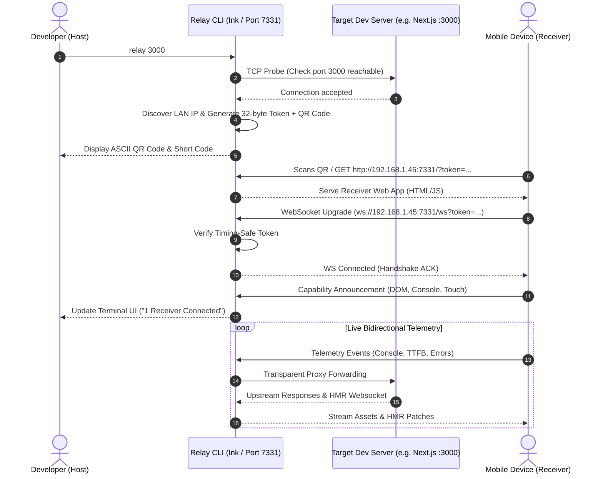
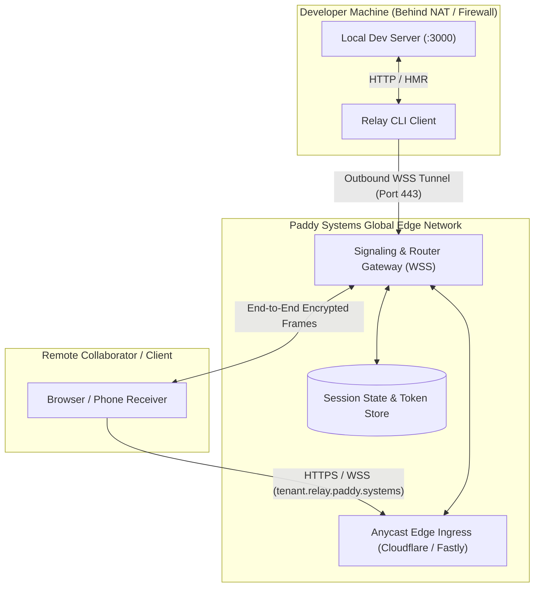
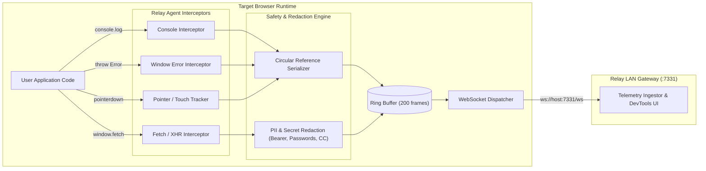

# Paddy Systems Relay — Architectural Concept Diagrams

Visual system diagrams illustrating the runtime topologies, message lifecycles, and security boundaries of Paddy Systems Relay.

---

## 1. Local LAN Direct Pairing Sequence

Demonstrates the zero-cloud, direct local area network handshake between the developer host terminal and mobile receiver device.

---

## 2. Remote Edge Tunnel Topology

Demonstrates the multi-region edge tunneling architecture for disparate network collaboration.

---

## 3. Client-Side Telemetry Pipeline

Demonstrates telemetry interception, buffering, PII sanitization, and dispatch inside the browser.

